# Project 01 — Basic Circuit Analyses with Cadence PSpice

> Source document: *实验一 PSpice 仿真（1）*
> Toolchain: Cadence OrCAD Capture CIS / PSpice 17.4

---

## 1. Objective

Become fluent with the Cadence OrCAD Capture CIS + PSpice environment, and use it to design and simulate four representative circuits in order to understand how each of PSpice's core analysis types maps onto a physical circuit behaviour:

1. Get to know the Capture / PSpice user interface and workflow.
2. Practise schematic entry and simulation set-up.
3. Characterise a Zener diode bias circuit, a band-pass network, a first-order RC differentiator and a common-emitter amplifier.

---

## 2. Background

### 2.1 DC sweep

A DC sweep makes one circuit parameter the independent variable over a specified range. For every value of that variable, PSpice computes the DC operating point of the circuit and records the requested output quantities. It is also the analysis used internally to obtain the small-signal linear-model parameters required by AC analysis, and the initial values required by transient analysis. Results are plotted with Probe as a transfer curve, e.g. *Vo–Vi*.

### 2.2 AC sweep (small-signal frequency response)

AC analysis linearises every semiconductor device about the DC operating point and computes the small-signal frequency response of the circuit. It yields magnitude and phase response (Bode plots) as well as transfer admittances.

### 2.3 Transient analysis

Transient analysis computes the time-domain response of the circuit to a given excitation: the initial state at *t* = 0 is found first, then the circuit is solved over a specified time interval with a chosen time step. Results are stored in a `.dat` file and displayed as waveforms in Probe. It is the most frequently used — and computationally most expensive — analysis type.

### 2.4 Bias-point (static operating point) analysis

With inductors short-circuited and capacitors open-circuited, and all sources set to their DC values, PSpice iterates to find the static operating point. The output reports every node voltage, the current through each voltage source, total circuit power, transistor bias voltages and currents, and the small-signal linearised model parameters at that operating point. Establishing a correct operating point is essential for amplifier design, because it fixes the small-signal parameters and therefore all of the amplifier's dynamic performance indices.

---

## 3. Method and results

### 3.1 Experiment A — DC sweep of a Zener bias circuit

A new PSpice-enabled project (*File ▸ New ▸ Project*) was created in an empty project directory.

| Figure | Description |
|--------|-------------|
| [fig-05](figures/fig-05-create-new-project.png) | Creating the new project |
| [fig-06](figures/fig-06-project-pspice-enabled.png) | Naming the project and enabling PSpice simulation |
| [fig-07](figures/fig-07-blank-project.png) | Creating a blank project |

The schematic below was drawn, then *PSpice ▸ New Simulation Profile* was used with **Analysis type = DC Sweep**, **Options = Primary Sweep**, sweeping source **V1** from **0 V to 5 V in 0.1 V steps**.

   
  <em>DC sweep schematic (R1 = 202 kΩ in series with Zener D1).</em>

After the run, `Trace ▸ Add Traces` → `V2(D1)` produced the transfer curve:

  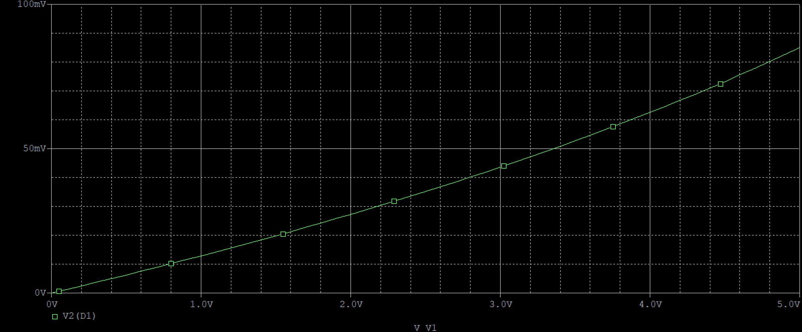 
  <em>Output voltage vs. input source voltage.</em>

**Discussion.** D1 never entered its regulation (breakdown) region. Used as a Zener, the output should have been clamped near **3 V**, but the measured data contains a point at **5.0 V** — i.e. the full supply voltage appears across the output. The current through the branch is far too small for the Zener to reach breakdown, because **R1 = 202 kΩ is several orders of magnitude too large** for the required bias current. The circuit therefore behaves as a resistive divider rather than a voltage reference. Correcting the design requires either reducing R1 to a value that supplies the specified Zener knee current at the minimum input voltage, or selecting a low-current Zener.

### 3.2 Experiment B — AC sweep of a band-pass network

   
  <em>Band-pass network used for the AC sweep.</em>

Simulation profile: **Analysis type = AC Sweep/Noise**, **Options = General Settings**, **Start Frequency = 1 Hz**, **End Frequency = 100 Meg**, **Points/Decade = 10**. Magnitude was plotted with `DB(V(out))`:

  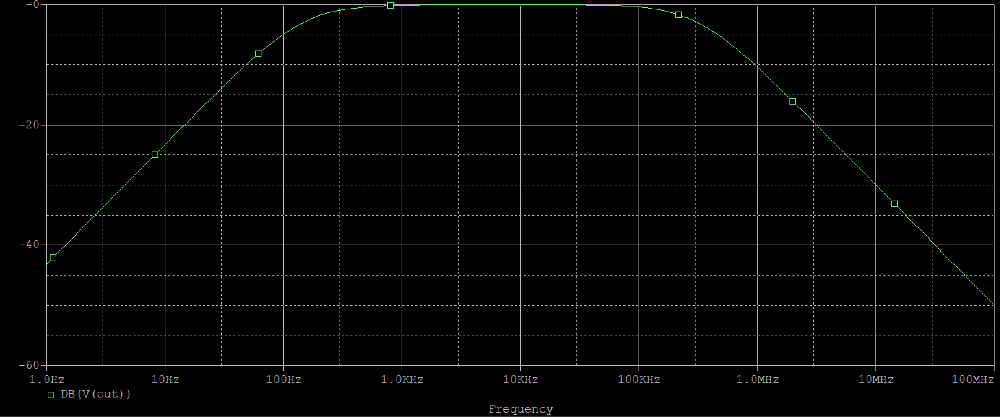 
  <em>Magnitude response in dB.</em>

A second Y-axis was added (`Plot ▸ Add Y Axis`) and `P(V(out))` was plotted to obtain magnitude and phase together:

  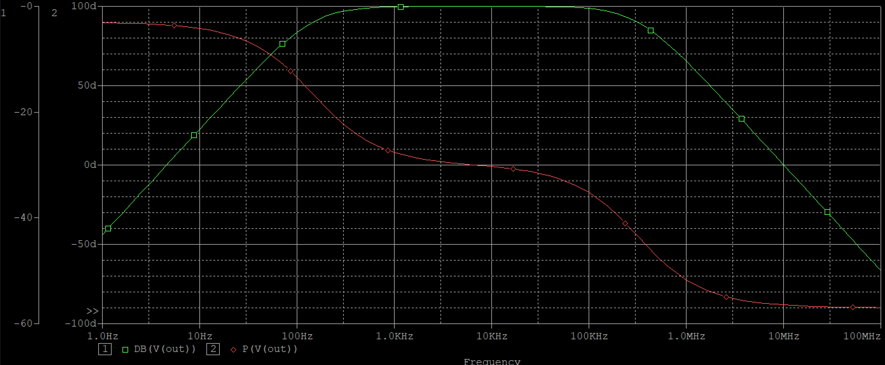 
  <em>Magnitude and phase response — the 3-dB bandwidth is limited by C1 at the low end and C2 at the high end.</em>

**Magnitude response (`DB(V(out))`)**

- *Low band (1 Hz – 100 Hz):* gain rises with frequency — a high-pass characteristic dominated by the C1 (0.5 µF) / R1–R2 network, consistent with the upward trend at the left of the plot.
- *Mid / high band (1 kHz – 1 MHz):* gain flattens — the circuit is in its pass-band and the gain is set by the resistor network. Any peaking observed here originates from the resonance introduced by C2 (500 pF).
- *Above ~100 kHz:* gain falls off, caused by the falling reactance of C2 (XC2 = 1 / 2πfC2) together with parasitic effects.

**Phase response (`P(V(out))`)**

- *Low frequency:* phase approaches **−90°**, the classic high-pass signature.
- *Pass-band:* phase tends to **0°** — no additional phase shift.
- *High frequency:* a phase transition appears, attributable to the pole/zero introduced by C2 (or by the op-amp, if present).

**Conclusion for this circuit.** The network is **band-pass**: the low-frequency cut-off is set by C1 and the resistor network (**≈ 46 Hz**) and the high-frequency cut-off by C2 (**≈ 100 kHz – 1 MHz**).

### 3.3 Experiment C — transient analysis of a first-order RC differentiator

   
  <em>First-order RC differentiator.</em>

Simulation profile: **Analysis Type = Time Domain (Transient)** with the parameters shown in [fig-16](figures/fig-16-transient-settings.png). The output was observed as `V(R1:2)`.

| Figure | Description |
|--------|-------------|
| [fig-17](figures/fig-17-pspice-toolbar.png) | PSpice toolbar |
| [fig-18](figures/fig-18-append-waveform-dat.png) | Adding a previously saved waveform with `File ▸ Append Waveform (.dat)` |
| [fig-19](figures/fig-19-waveform-comparison-setup.png) | Selecting the saved `.dat` file |
| [fig-20](figures/fig-20-c1-20uf-vs-100uf.png) | Overlaid transient responses |

The waveform for **C1 = 20 µF** was saved, then the component value was changed, the simulation re-run, and the stored waveform appended so that the two responses could be compared directly:

  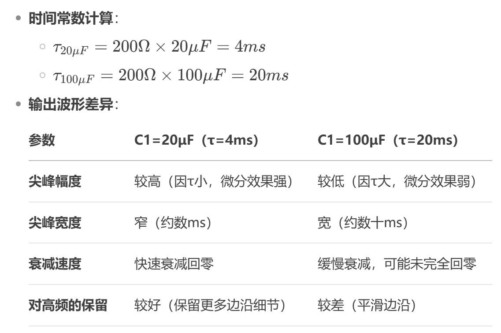 
  <em>Transient response, C1 = 20 µF vs. C1 = 100 µF.</em>

**Discussion.**

| Capacitor | Behaviour |
|-----------|-----------|
| **Smaller C (20 µF)** | Differentiation is more pronounced, the output spikes are sharper — well suited to detecting fast transitions (e.g. edge detection in digital circuits). |
| **Larger C (100 µF)** | Differentiation is weaker and the output approaches the low-frequency content of the input, equivalent to lowering the cut-off frequency of the high-pass network. |

Design rule extracted from the experiment: choose a **small capacitor** when short pulses must be captured accurately; choose a **larger capacitor** when noise or high-frequency interference must be smoothed out.

### 3.4 Experiment D — bias-point analysis of a common-emitter amplifier

  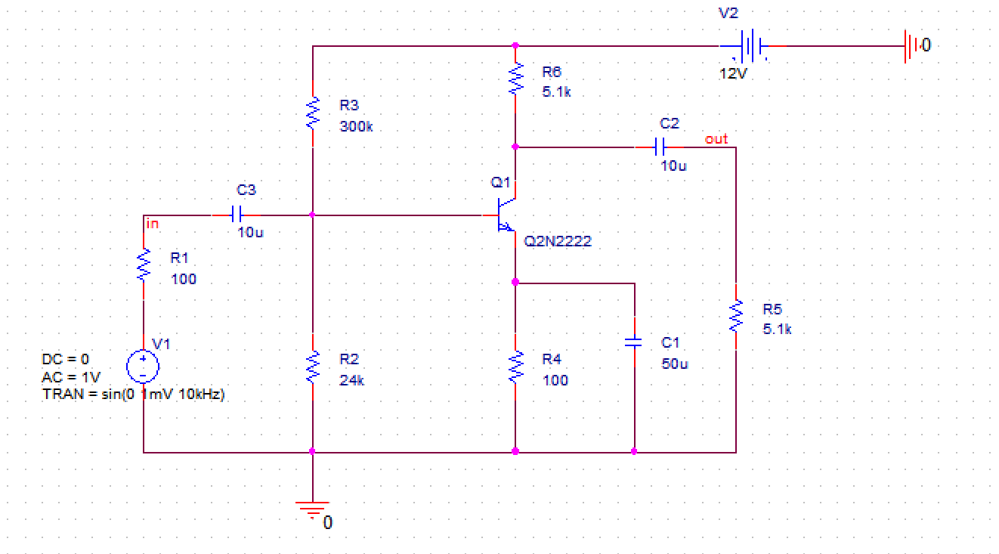 
  <em>Common-emitter amplifier used for operating-point analysis.</em>

**Analysis Type = Bias Point** was selected, the simulation run, and the result read from `View ▸ Output File`.

  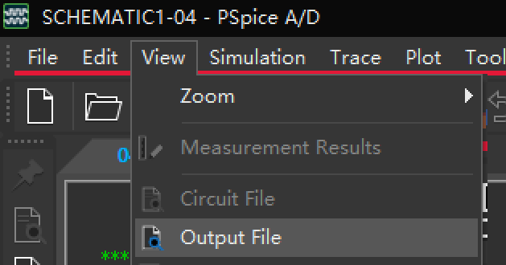 
  <em>PSpice output file containing the bias-point solution.</em>

The three quantities that define the operating point are **VCEQ**, **IBQ** and **ICQ**. A good operating point lies in the active region of the transistor output characteristics, ideally near the middle of the AC load line.

**Measured results**

| Device | VCEQ | ICQ | IBQ | β = IC/IB | Verdict |
|--------|-----------------|----------------|----------------|-------------------------------|---------|
| **Q2N2222** | 6.71 V | 1.02 mA | 6.4 µA | ≈ **159** | Operating point sits mid-way in the active region — suitable for linear amplification |
| **Q2N2220** | 11.2 V | 0.147 mA | 10.7 µA | ≈ **13.7** | Operating point shifted towards cut-off (VCE too high, IC too small) — risks clipping / cut-off distortion |

  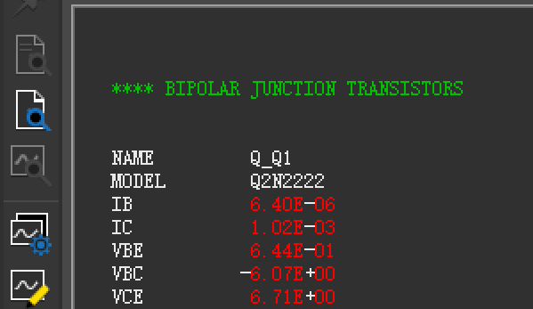
   <em>Q2N2222 operating point</em>

  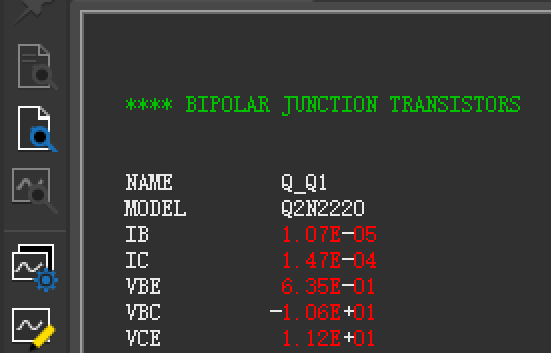
   <em>Q2N2220 operating point — high VCE, low IC</em>

**Discussion.** With the same external bias network, the two transistors settle in very different places. Q2N2222 delivers ~7× the collector current of Q2N2220 and lands close to the centre of the load line, whereas Q2N2220 is pushed towards the cut-off corner; its d.c. current gain (β ≈ 13.7) is an order of magnitude lower than that of the Q2N2222 (β ≈ 159). This is the textbook demonstration that a bias network must be designed for the *actual* device β, or made β-insensitive by strong emitter degeneration / a stiff divider — otherwise device substitution alone can destroy the amplifier's headroom.

  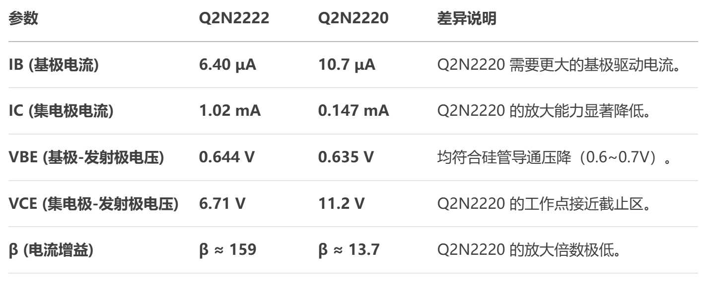 
  <em>Side-by-side comparison of the two transistors.</em>

---

## 4. Discussion

Several conclusions follow directly from the four experiments.

- **Passive component values decide whether a circuit works at all.** In the Zener bias circuit the single mistake of using R1 = 202 kΩ was enough to move the diode from a voltage-reference behaviour to a passive divider; the topology was correct, the biasing was not.
- **Time-step and simulation-length settings dominate transient accuracy.** The transient differentiator and the band-pass sweep both showed that the resolution of the analysis (step size, points per decade, total time) directly limits what can be resolved — a caution that applies to every SPICE analysis.
- **Parasitics are first-class citizens.** The 500 pF capacitor that was meant to be a minor detail in the band-pass network ended up defining the entire high-frequency corner.
- **Device selection is a design variable, not an afterthought.** The Q2N2222 / Q2N2220 comparison quantified how much β spread moves the quiescent point, and therefore how much design margin is required.
- **Linearisation is the price of AC analysis.** Every AC result here is valid only because a sensible DC operating point existed first — the two analyses are not independent.

## 5. Conclusions and reflection

The laboratory gave a complete first pass over the PSpice design loop — schematic entry, simulation set-up, trace selection, post-processing and documentation — for the four analysis types that underpin all later work in the course. The most valuable outcome was learning to read a disagreement between the expected and the simulated curve as *information about the circuit* rather than as a tooling problem: the Zener curve, the asymmetric Bode plot and the two mismatched bias points each pointed at a specific, identifiable cause. That habit — build, measure, explain the discrepancy — is what the remaining five laboratories build on.

---

## Appendix — full figure gallery

<strong>Click to expand all 26 captures from this laboratory</strong>

| # | Figure | Description |
|---|--------|-------------|
| 01 | 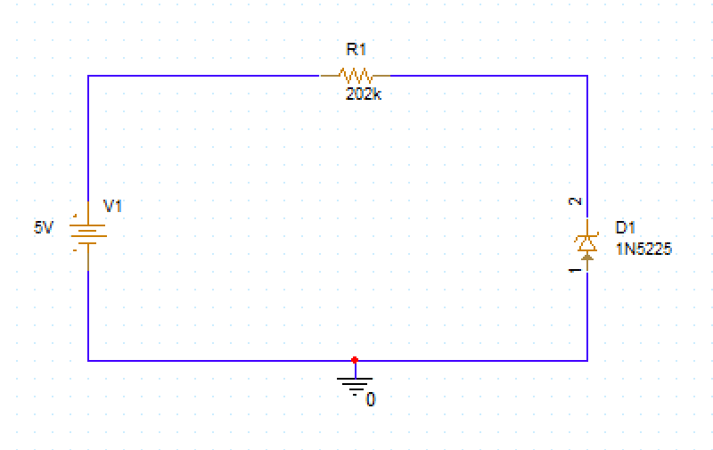 | Reference schematic — DC sweep |
| 02 | 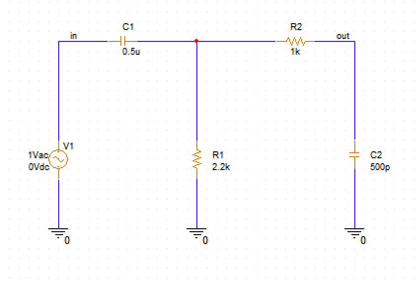 | Reference schematic — AC sweep |
| 03 | 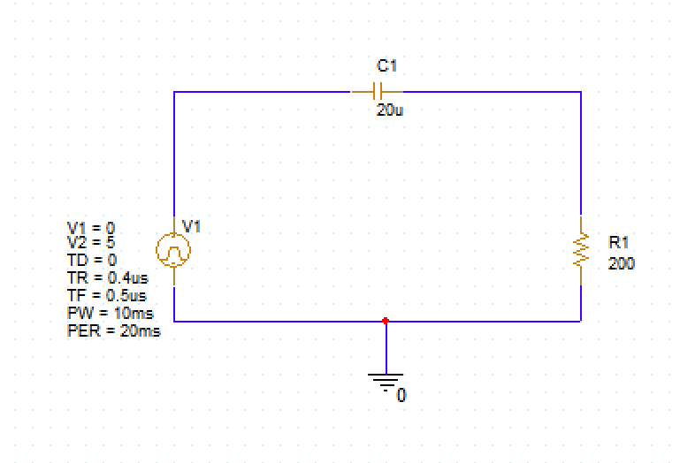 | Reference schematic — transient |
| 04 |  | Reference schematic — bias point |
| 05 | 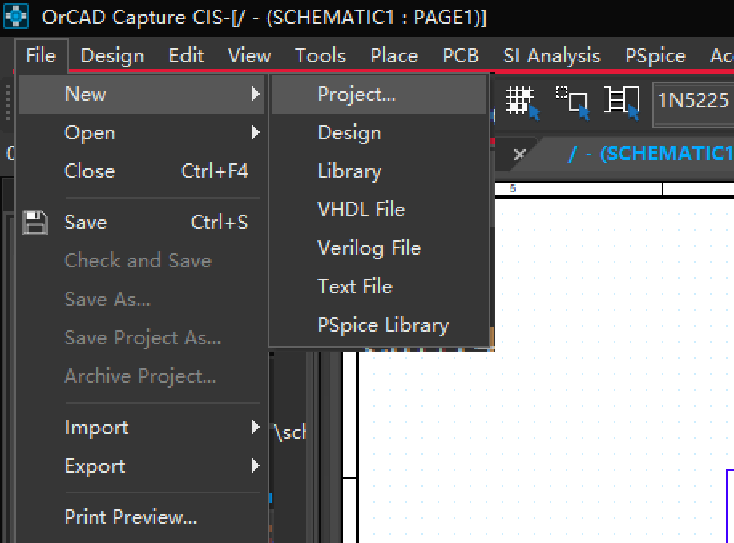 | Creating a new project |
| 06 | 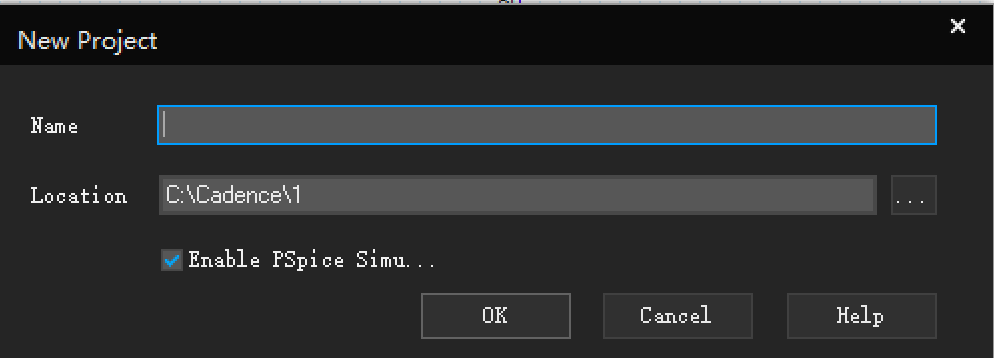 | Naming the project, PSpice enabled |
| 07 | 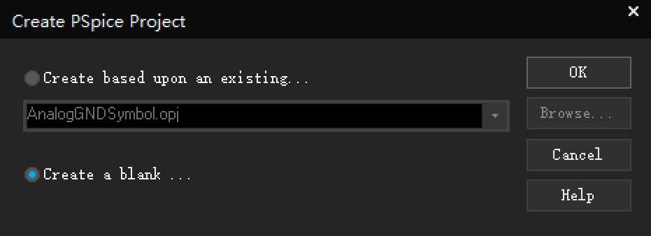 | Creating a blank project |
| 08 |  | DC analysis schematic |
| 09 | 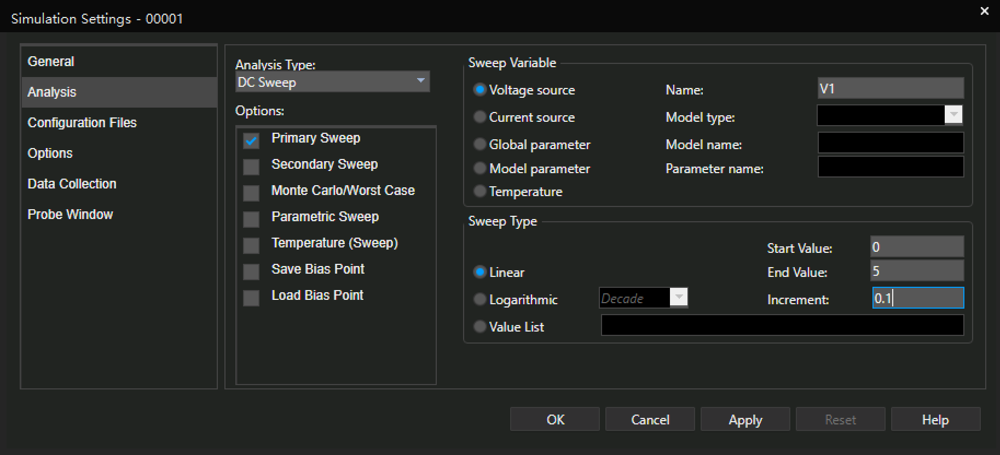 | DC sweep parameters |
| 10 |  | DC sweep result |
| 11 |  | AC analysis schematic |
| 12 | 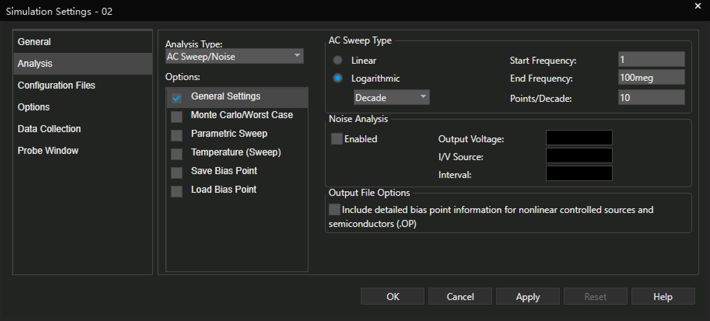 | AC sweep parameters |
| 13 |  | Magnitude response in dB |
| 14 |  | Magnitude and phase |
| 15 |  | Transient schematic |
| 16 | 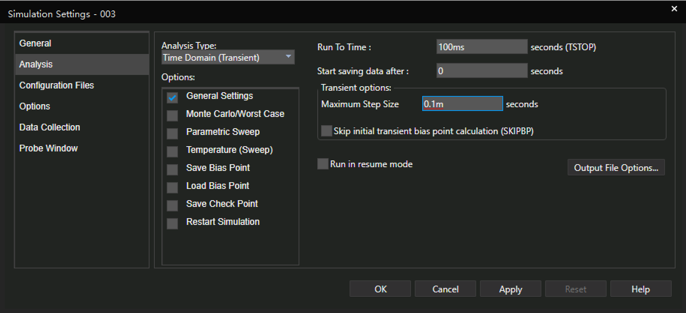 | Transient parameters |
| 17 | 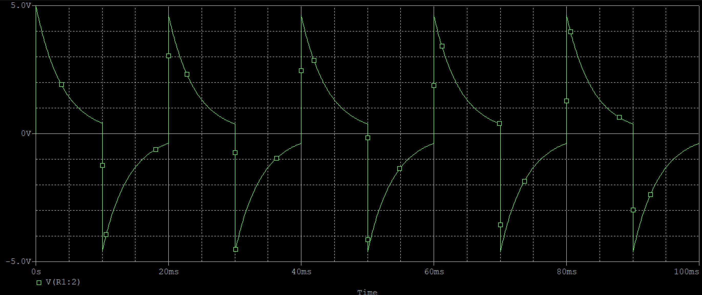 | PSpice toolbar |
| 18 | 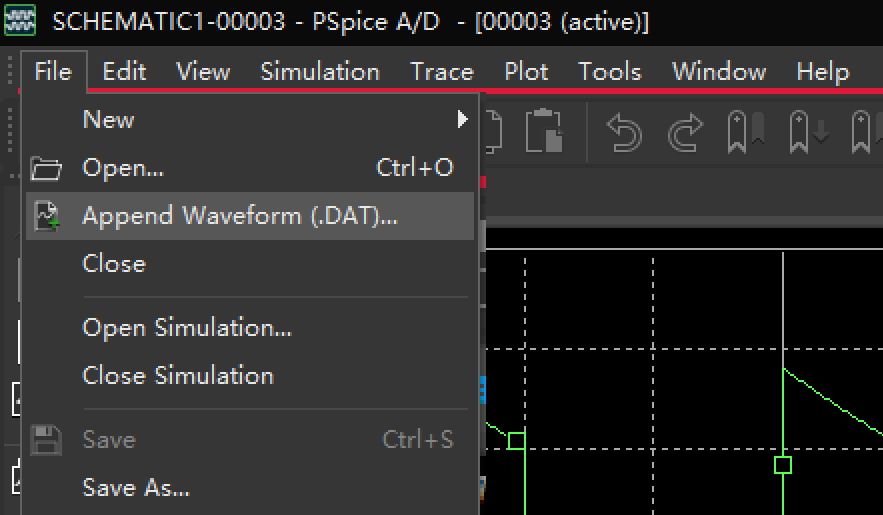 | `Append Waveform (.dat)` |
| 19 | 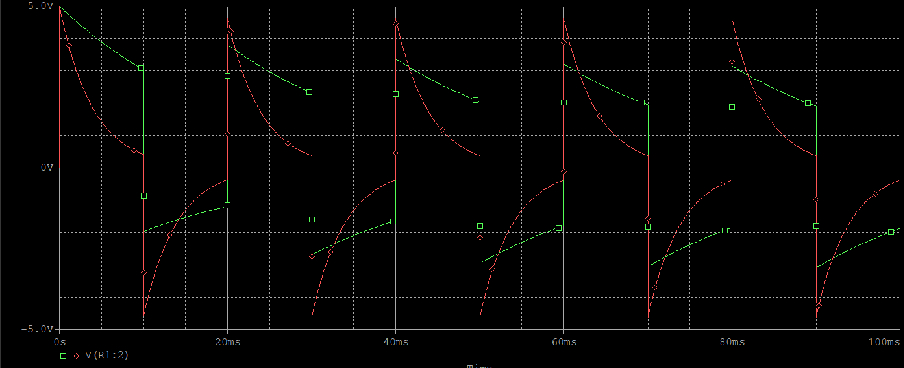 | Waveform comparison set-up |
| 20 |  | C1 = 20 µF vs 100 µF |
| 21 |  | Common-emitter schematic |
| 22 | 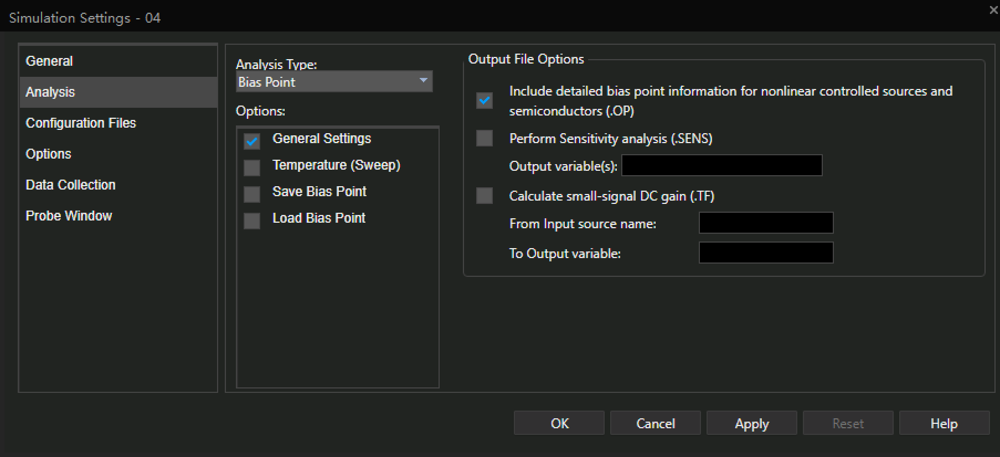 | Bias-point parameters |
| 23 |  | Output file view |
| 24 |  | Q2N2222 bias values |
| 25 |  | Q2N2220 bias values |
| 26 |  | Q2N2222 vs Q2N2220 |

