# Project 02 — CMOS Inverter: Static & Dynamic Characterisation with PSpice

> Source document: *实验二 PSpice 仿真（2）*
> Toolchain: Cadence OrCAD Capture CIS / PSpice 17.4

---

## 1. Objective

1. Use Cadence OrCAD PSpice for advanced circuit design and simulation.
2. Learn to **encapsulate a schematic as a reusable symbol** (sub-circuit + custom part library) in OrCAD.
3. Study the structure, operating principle and simulation methodology of a **CMOS inverter**.

---

## 2. Background

### 2.1 The PSpice Model Editor

PSpice ships with a model conversion and editing tool, the **Model Editor**, which converts externally supplied model parameter files into PSpice model files and can generate a corresponding symbol for them. A complete model-creation and application cycle has three stages:

1. Import the model file.
2. Build the model symbol.
3. Apply the model in a simulation.

### 2.2 CMOS inverter operating principle

The CMOS inverter is a pair of complementary MOSFETs:

- **PMOS** — source tied to the supply rail (VDD), drain joined to the NMOS drain to form the output Vout.
- **NMOS** — source tied to ground, drain joined to the PMOS drain.
- **Gates** — both gates are tied together and form the input Vin.

| Input | PMOS | NMOS | Output |
|-------|------|------|--------|
| Vin = 0 V | VGS,P = −VDD → **on** | VGS,N = 0 V → **off** | pulled up to VDD → logic **1** |
| Vin = VDD | VGS,P = 0 V → **off** | VGS,N = VDD → **on** | pulled down to GND → logic **0** |

**Core characteristics**

1. **Zero static power** — in either stable state one device is always off, so there is no d.c. path from VDD to ground.
2. **Rail-to-rail output** — the output reaches the full 0 V and VDD.
3. **Extremely high input impedance** — the gate is an insulator and draws essentially no current.

**Switching behaviour**

- Input low → high: the PMOS turns off progressively while the NMOS turns on; the output discharges to ground through the NMOS.
- Input high → low: the NMOS turns off progressively while the PMOS turns on; the output charges from VDD through the PMOS.

**Sizing**

The PMOS is normally made wider than the NMOS (in this experiment **Wp = 1.275 µm vs. Wn = 0.375 µm**) because hole mobility is lower than electron mobility and the larger geometry compensates for it. This balances the two devices (βn ≈ βp) and equalises the rise and fall times.

  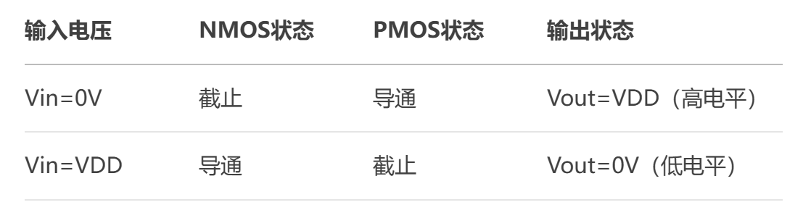
   <em>Conduction states of the CMOS inverter.</em>

  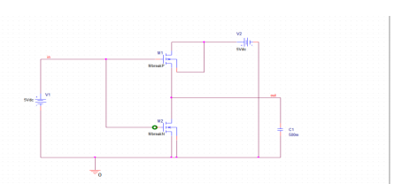
   <em>Reference simulation circuit.</em>

### 2.3 Static characteristics in a word

The static characteristic of a CMOS inverter describes its behaviour when input and output are both settled — i.e. the voltage transfer characteristic (VTC), the noise margins and the static power. The VTC relates Vin to Vout and determines the logic threshold, the transition-region gain and hence the circuit's noise immunity.

  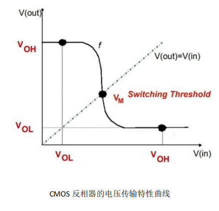
   <em>Voltage transfer characteristic (VTC) of a CMOS inverter.</em>

---

## 3. Method and results

### 3.1 Part I — Designing the CMOS inverter and encapsulating it as a symbol

#### 3.1.1 Schematic entry

In Cadence OrCAD Capture CIS a new project was created and the inverter was built from **`MBreakN`** (NMOS) and **`MBreakP`** (PMOS). Device dimensions were set to

| Device | W | L |
|--------|---|----|
| NMOS | 0.375 µm | 0.25 µm |
| PMOS | 1.275 µm | 0.25 µm |

VCC, GND, Vin and Vout were wired up, and **`PortBoth-L`** symbols were placed to create the external ports required for encapsulation. Note that **GND must be connected even inside a sub-circuit**, otherwise the design cannot be simulated. Device parameters were edited by double-clicking the transistor and applying `W` and `L` in the parameter dialog (**Apply** must be clicked to commit the change).

  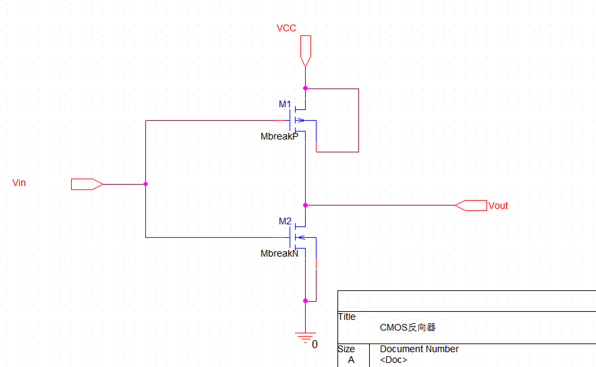
   <em>Inverter schematic with the external ports used for packaging.</em>

  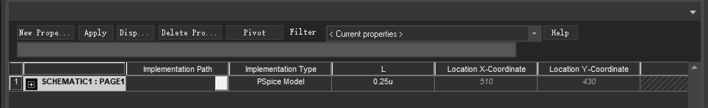
   <em>Setting the W and L parameters on the MOS devices.</em>

#### 3.1.2 Generating the sub-circuit netlist

`Tools ▸ Create Netlist` was used with the default output path and the PSpice option **“Create SubCircuit Format Netlist”** ticked (Descend mode kept). This turns the current sheet into a standard, re-callable sub-circuit block.

  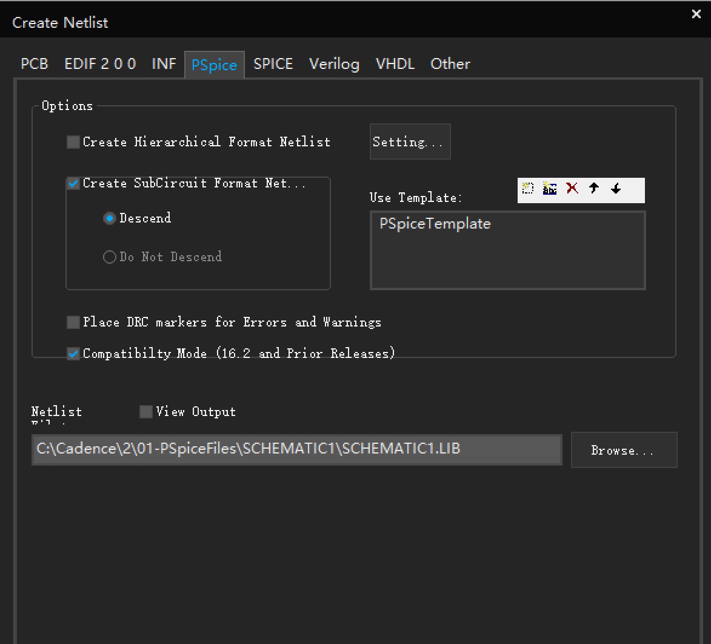
   <em>Netlist generation options — sub-circuit format selected.</em>

#### 3.1.3 Converting the netlist into a Capture symbol

The PSpice **Model Editor** was opened and the generated netlist library was loaded, then exported to a Capture part library:

1. `File ▸ Open…` → select the `.lib` file created by the netlist step.
2. `File ▸ Export to Capture Part Library…` → keep the default in/out paths, click **OK**; a `.olb` part library is generated.
3. `File ▸ Model Import Wizard [Capture]` → confirm the default library path and `.olb` directory, review the generated symbol, and click **Finish**. With no errors reported in the log, the encapsulation is complete.

| Step | Figure |
|------|--------|
| Model Editor | [fig-07](figures/fig-07-pspice-model-editor.png) |
| Opening the custom library | [fig-08](figures/fig-08-model-editor-open-lib.png) |
| Selecting the generated `.lib` | [fig-09](figures/fig-09-lib-file-selected.png) |
| Export to Capture part library | [fig-10](figures/fig-10-export-to-capture-part-library.png) |
| Model Import Wizard | [fig-11](figures/fig-11-model-import-wizard.png) |
| Generated symbol | [fig-12](figures/fig-12-generated-part-symbol.png) |

  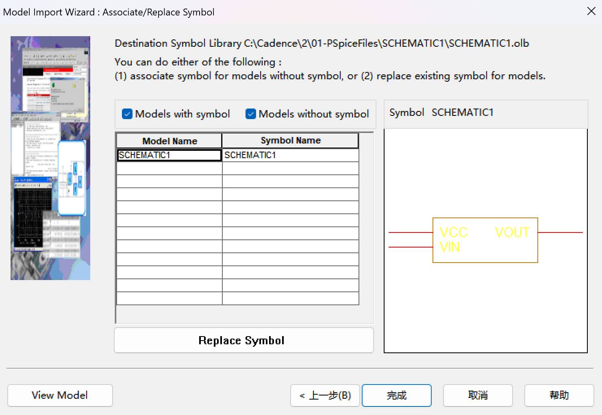
   <em>The generated CMOS inverter symbol — pin connectivity verified before saving.</em>

#### 3.1.4 Wrapper test bench — static behaviour

A new project was created and the custom part was added through `Place Part ▸ Add Library` → the `.olb` file.

  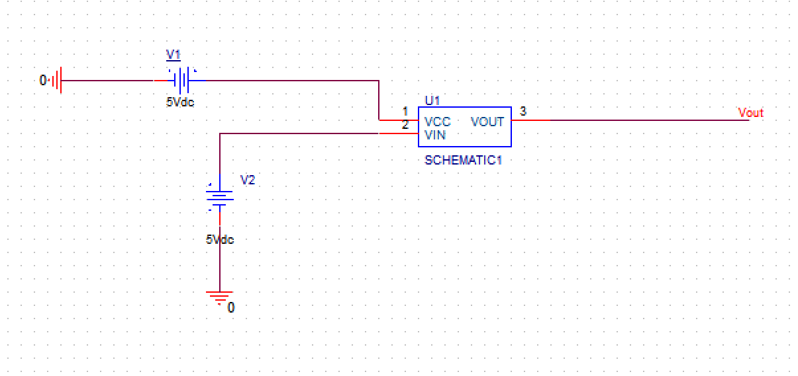
   <em>Wrapper test bench used to verify the encapsulated inverter.</em>

Simulation profile: **Analysis type = DC Sweep**, **Options = Primary Sweep**, source **V2** swept **0 → 5 V in 0.01 V steps**. Crucially, the packaged library **`CMOS_FZ.LIB`** had to be added under `Configuration Files ▸ Filename ▸ Browse ▸ Library`, otherwise the simulation cannot resolve the sub-circuit.

  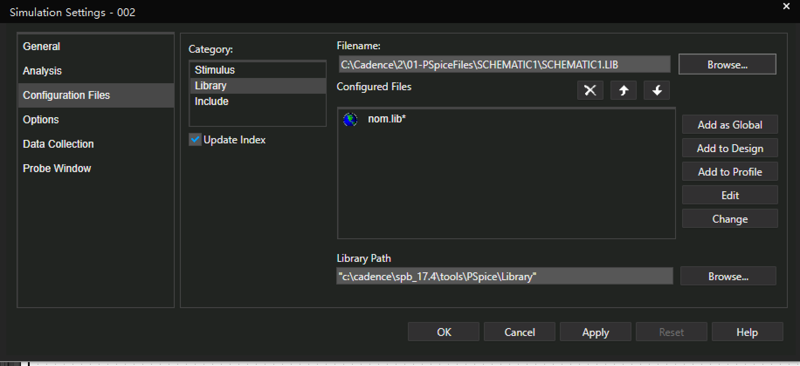
   <em>Adding <code>CMOS_FZ.LIB</code> to the simulation profile.</em>

`Trace ▸ Add Trace ▸ V(out)` gives the VTC of the *packaged* inverter:

  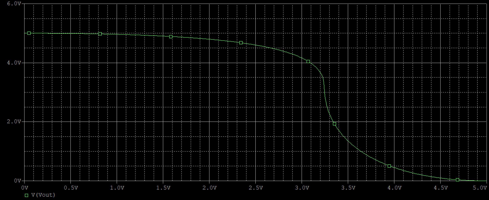
   <em>Static VTC of the encapsulated inverter — matches the un-packaged reference.</em>

#### 3.1.5 Wrapper test bench — dynamic behaviour

Replacing the DC source with a pulse source gives the dynamic response, plotted as V(out) together with V(in):

  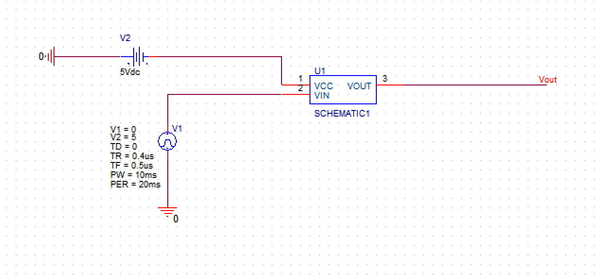
   <em>Wrapper test bench driven by a pulse source.</em>

  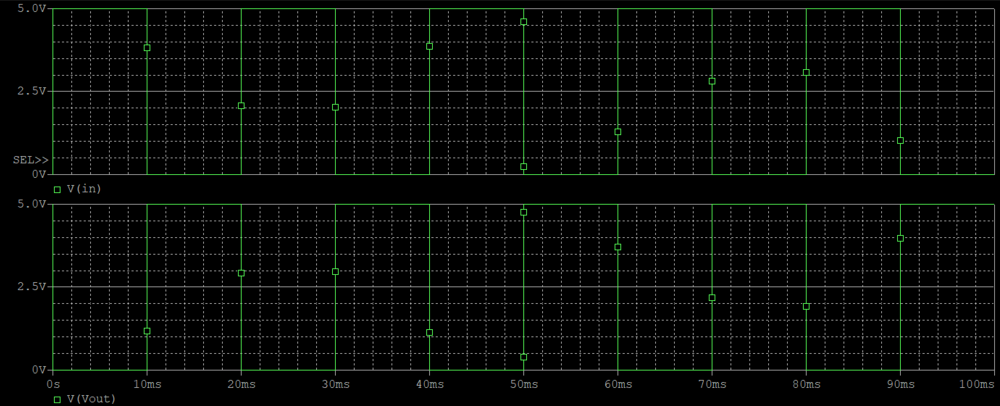
   <em>Dynamic response of the encapsulated inverter — behaviour is as expected, confirming that the packaging preserved the electrical characteristics.</em>

### 3.2 Part II — Static characteristics of the CMOS inverter

  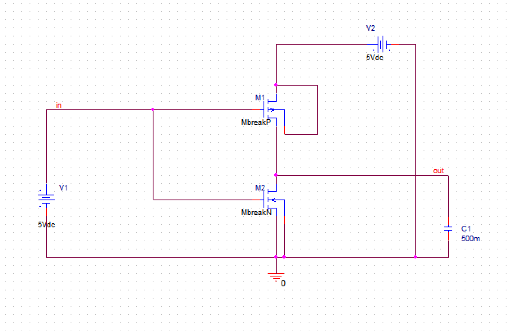
   <em>Schematic for the DC sweep (devices sized as above).</em>

**Analysis type = DC Sweep**, **Primary Sweep**, source **V1** swept **0 → 6 V in 0.01 V steps**. `V(out)` and `V(in)` were plotted together:

  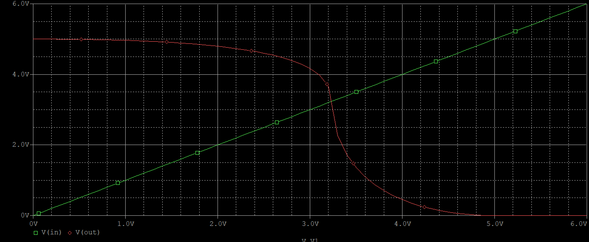
   <em>Voltage transfer characteristic of the CMOS inverter.</em>

**Reading the curve.** For low Vin the output sits near VDD — the inverter outputs a logic high. As Vin rises the output begins to fall; as Vin approaches VDD/2 the output collapses steeply — the **transition (threshold) region**. Above that threshold the output approaches 0 V, i.e. a logic low.

#### 3.2.1 Effect of the supply voltage

Five runs were made with **V1 = V2 = 1 V, 2 V, 3 V, 4 V, 5 V**:

  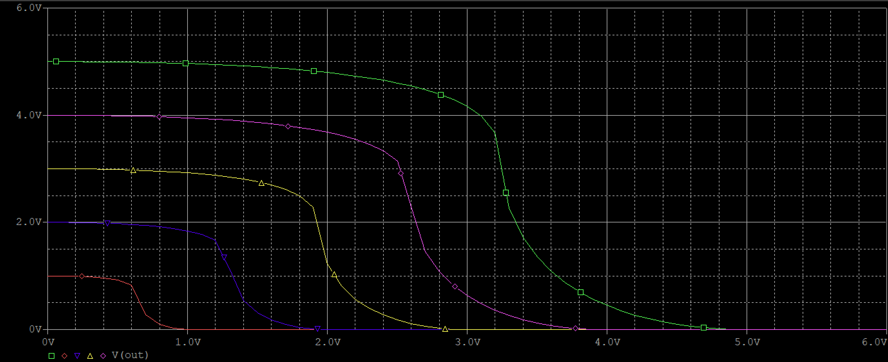
   <em>VTC family for VDD = 1 V … 5 V.</em>

The family of curves shows a systematic shift: as VDD increases from 1 V to 5 V the **transition region moves to the right** and the **threshold voltage Vth increases**, while the **slope in the transition region (i.e. the gain) also increases**. Physically this is the modulation of the inverter's switching behaviour by the supply: at a higher VDD a larger input voltage is needed to flip the state, and the device transconductance gm is enhanced, sharpening the transition.

#### 3.2.2 Effect of device geometry (W and L)

| Case | Change | Figure |
|------|--------|--------|
| NMOS W | 0.375 µm → **0.7 µm** | [fig-23](figures/fig-23-nmos-w-variation.png) |
| PMOS W | 1.275 µm → **2 µm** | [fig-24](figures/fig-24-pmos-w-variation.png) |
| NMOS L | 0.25 µm → **0.5 µm** | [fig-25](figures/fig-25-nmos-l-variation.png) |
| PMOS L | 0.25 µm → **0.5 µm** | [fig-26](figures/fig-26-pmos-l-variation.png) |

In each figure the **red** curve is the original characteristic and the **green** curve the modified one.

  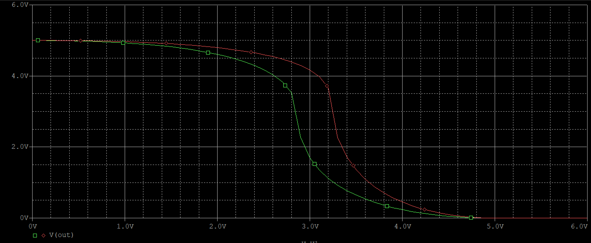
   <em>NMOS W = 0.375 µm (red) vs. 0.7 µm (green).</em>

  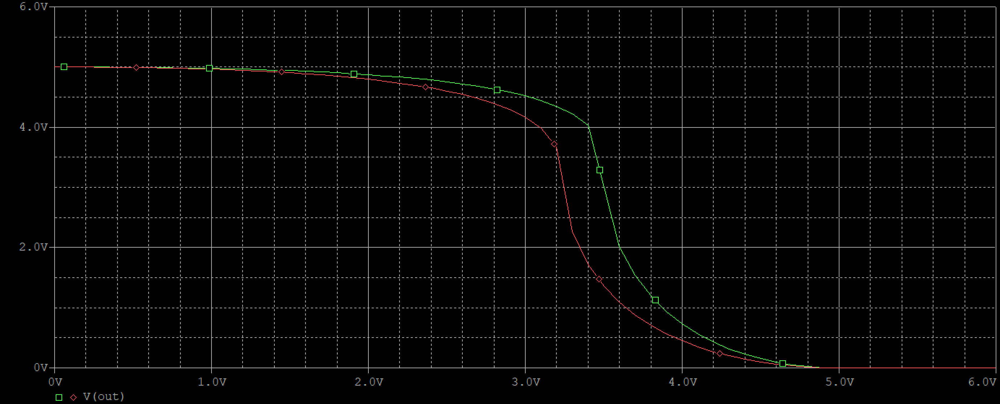
   <em>PMOS W = 1.275 µm (red) vs. 2 µm (green).</em>

**Discussion — channel width W**

- *Widening the NMOS* raises its saturation current (a wider device carries more current), **reduces the fall time** (a stronger NMOS discharges the load capacitance faster) and **increases the slope of the transition region**, i.e. the inverter gain.
- *Widening the PMOS* raises its saturation current and **reduces the rise time** (a stronger PMOS charges the load capacitance faster).

  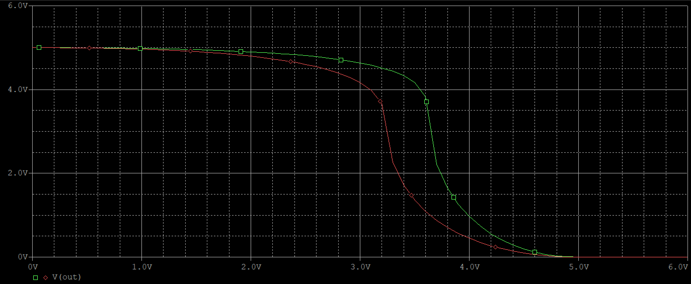
   <em>NMOS L = 0.25 µm (red) vs. 0.5 µm (green).</em>

  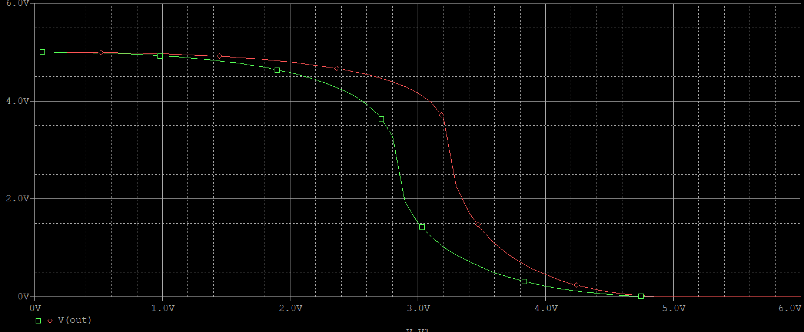
   <em>PMOS L = 0.25 µm (red) vs. 0.5 µm (green).</em>

**Discussion — channel length L**

- *Shortening L* increases the saturation current (short-channel effects), can **lower the threshold voltage**, and shortens both rise and fall times because the device turns on more easily.
- *Lengthening L* lowers the saturation current (a longer channel means a higher channel resistance), tends to **raise the threshold voltage**, and lengthens rise/fall times because a higher gate voltage is needed to turn the device on.

### 3.3 Part III — Dynamic characteristics of the CMOS inverter

  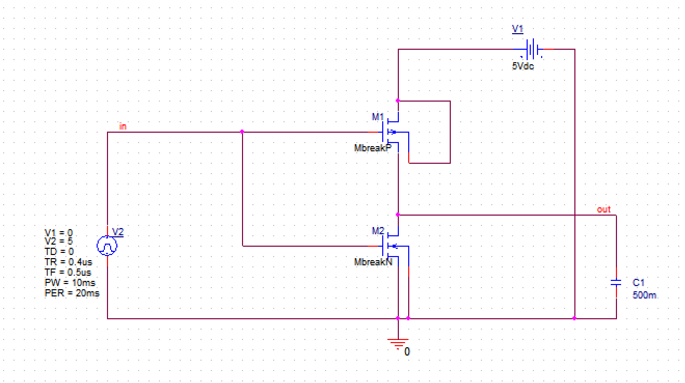
   <em>Load-capacitance test bench.</em>

**Analysis type = Time Domain**, **Options = General Settings**, start time 0, **total duration 100 ms**. With **C = 30 nF** the output was observed as V(out), and the input V(in) was added in a second plot (`Plot ▸ Add Plot to Window`):

  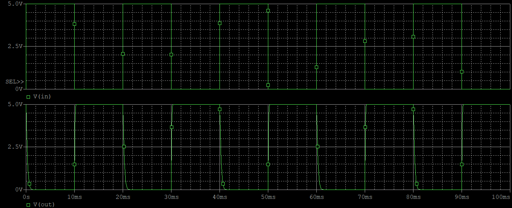
   <em>Input and output waveforms, C = 30 nF.</em>

To quantify the effect of the load, the simulation was repeated for **C = 3 nF, 30 nF and 300 nF**:

  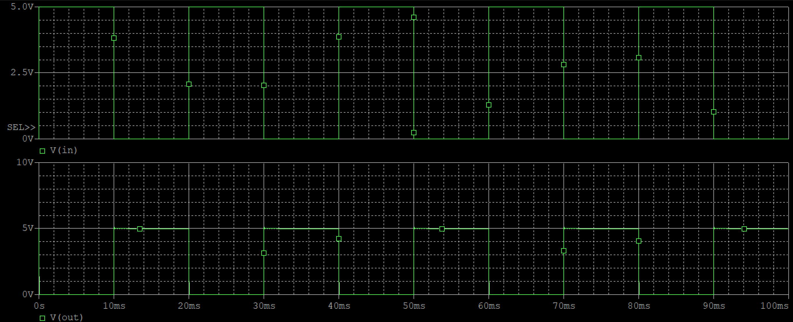
   <em>C = 3 nF.</em>

  
   <em>C = 30 nF.</em>

  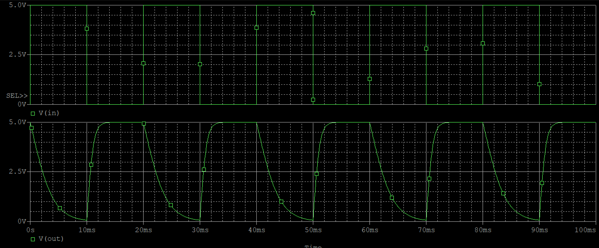
   <em>C = 300 nF.</em>

**Discussion — load capacitance CL**

| Case | Observed behaviour |
|------|--------------------|
| **CL = 3 nF (small)** | Steep rise/fall edges; average propagation delay tpd below 10 ns; small charge/discharge time constant τ ≈ RC. High-speed response. |
| **CL = 300 nF (large)** | Rise/fall times lengthened by roughly two orders of magnitude; propagation delay increases into the microsecond range; τ grows strongly; visible waveform degradation (reduced slope). |

The load capacitance is inversely related to circuit speed (tpd ∝ CL). The physical origin is that the charge/discharge current is I = CL · dV/dt: a larger CL requires a longer charge/discharge time for a given transistor current, which directly degrades the propagation delay and therefore the maximum operating frequency.

### 3.4 Part IV — Packaging the inverter into the SPICE model library

The packaging flow of §3.1 was repeated as a standalone exercise. The schematic sheet was renamed **`CMOS_FZ`**, then `Place Port` → **`PORTBOTH-L/CAPSYM`** was used to add the external ports to the supply-less, output-port-less simulation schematic.

| Step | Figure |
|------|--------|
| Complete symbol-level schematic (ports removed from the simulation sheet) | [fig-33](figures/fig-33-symbol-level-schematic.png) |
| `Tools ▸ Create Netlist` with sub-circuit output | [fig-34](figures/fig-34-create-netlist-dialog.png) |
| Model Editor menu (Capture ▸ Done) | [fig-35](figures/fig-35-model-editor-open.png) |
| `File ▸ Open` → `CMOS` added to the Model List | [fig-36](figures/fig-36-model-import-wizard.png) |
| Final encapsulated part symbol | [fig-37](figures/fig-37-part-symbol-generated.png) |
| Wrapper test bench `CMOS_FZ_TEST` | [fig-38](figures/fig-38-wrapper-test-schematic.png) |

A dedicated wrapper project **`CMOS_FZ_TEST`** was then created to test the packaged part:

  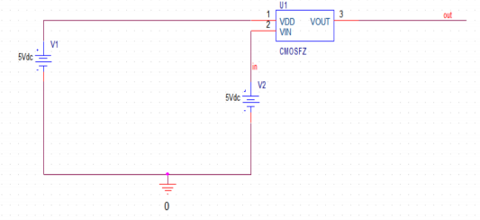
   <em>Wrapper test bench for the packaged <code>CMOS_FZ</code> part.</em>

  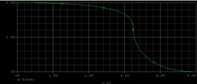
   <em>Static VTC obtained from the packaged symbol (DC sweep, V2 = 0–5 V, 0.01 V step).</em>

  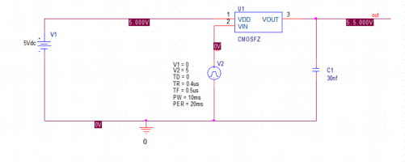
   <em>Pulse-source version of the wrapper test bench.</em>

  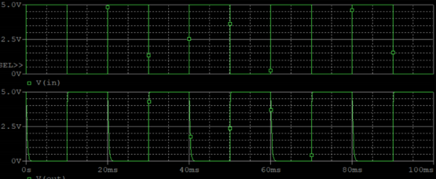
   <em>Dynamic response of the packaged part — consistent with the flat schematic.</em>

---

## 4. Discussion

- **Encapsulation works only if the electrical environment is preserved.** The two errors that cost the most time were file-path problems during export and a missing `CMOS_FZ.LIB` entry in the simulation profile. Both are *configuration* failures, not design failures — and both cause a simulation that simply cannot resolve the sub-circuit. Checking that a packaged part reproduces the flat schematic (fig-16 / fig-39) is the only reliable acceptance test.
- **The VTC is a design surface, not a single curve.** Sweeping VDD, W and L mapped the inverter's behaviour onto a family of characteristics: supply voltage translates the threshold and sharpens the transition; device width moves the trip point (because it changes the βn/βp balance) and the gain; device length mainly changes drive strength and threshold.
- **Speed is set by the load, not by the logic.** The 100× increase in CL produced roughly a 100× increase in delay, confirming tpd ∝ CL and the I = CLdV/dt relationship. In a real design the fan-out, interconnect and pad capacitance therefore dominate the achievable clock frequency.
- **There is a genuine trade-off surface.** Making the devices wider improves drive and raises gain, but increases gate and diffusion capacitance and therefore dynamic power and self-loading. The sizing chosen here (Wp/Wn ≈ 3.4) is the standard mobility-compensation compromise rather than an optimum for any single metric.

## 5. Conclusions and reflection

This laboratory was the first time the full *design → package → verify* chain of an IC design flow was executed end to end. Three things carried over into later work:

1. **Parameterised studies.** Changing one variable at a time (VDD, then W, then L, then CL) and reading the delta off the curve is the most efficient way to build intuition for a circuit, and it scales directly to SPICE corner analysis.
2. **Attention to detail in tooling.** Wrong file paths, un-imported model parameters and unconnected grounds each blocked the flow. Precision in the tool configuration is as important as precision in the circuit.
3. **Explicit trade-off reasoning.** Raising switching speed costs power; increasing load drive costs area and speed. Design is the act of choosing a point on that surface for a given application, not of maximising any single figure of merit.

---

## Appendix — full figure gallery

<strong>Click to expand all 41 captures from this laboratory</strong>

| # | Figure | Description |
|---|--------|-------------|
| 01 |  | CMOS inverter conduction states |
| 02 |  | Reference circuit |
| 03 |  | VTC concept |
| 04 |  | Inverter schematic with ports |
| 05 |  | W/L parameter entry |
| 06 |  | Netlist options |
| 07 |  | PSpice Model Editor |
| 08 | 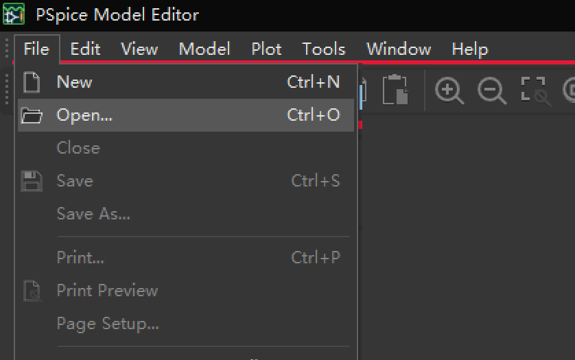 | Opening the library |
| 09 | 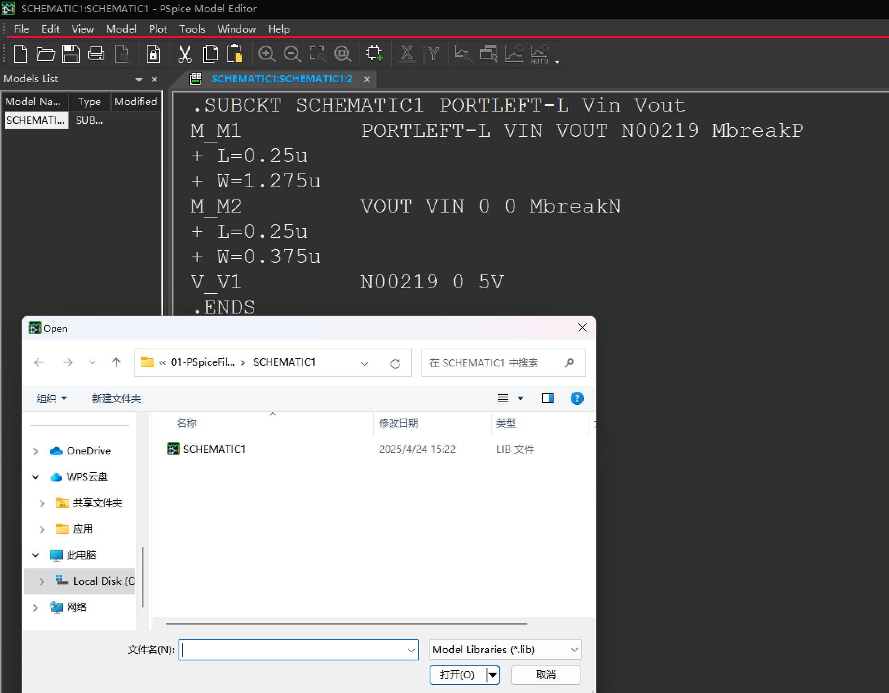 | `.lib` file selected |
| 10 | 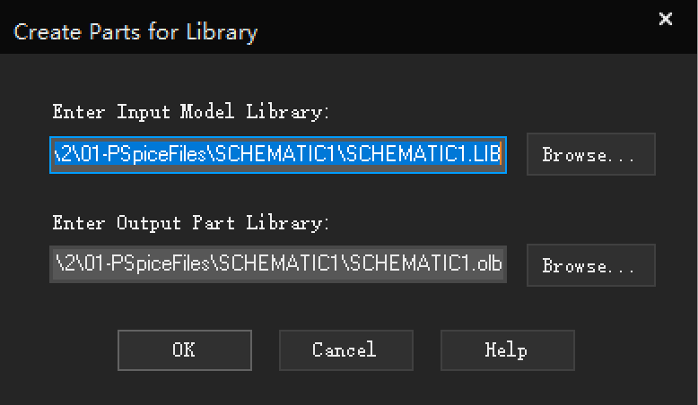 | Export to Capture part library |
| 11 | 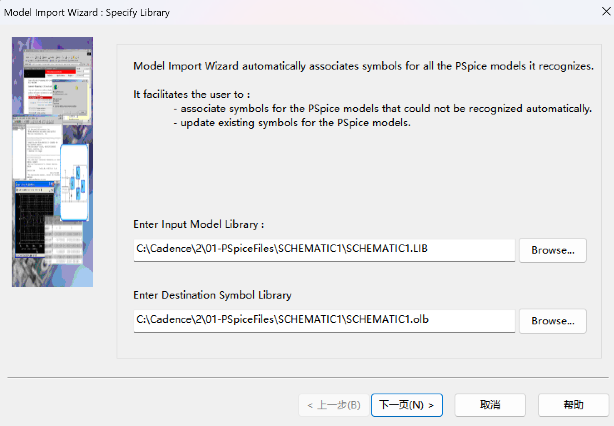 | Model Import Wizard |
| 12 |  | Generated symbol |
| 13 | 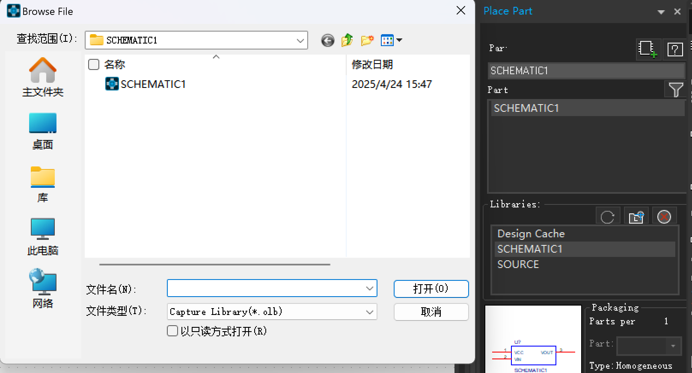 | Adding the custom library |
| 14 |  | Wrapper static test bench |
| 15 |  | Configuration Files → Library |
| 16 |  | Packaged inverter VTC |
| 17 |  | Pulse-source wrapper |
| 18 |  | Packaged inverter transient |
| 19 |  | Static analysis schematic |
| 20 | 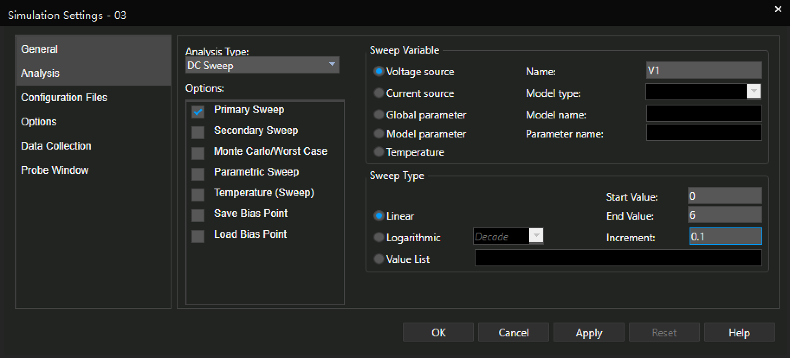 | DC sweep settings |
| 21 |  | Vout vs Vin |
| 22 |  | VTC vs VDD |
| 23 |  | NMOS W variation |
| 24 |  | PMOS W variation |
| 25 |  | NMOS L variation |
| 26 |  | PMOS L variation |
| 27 |  | Transient schematic |
| 28 | 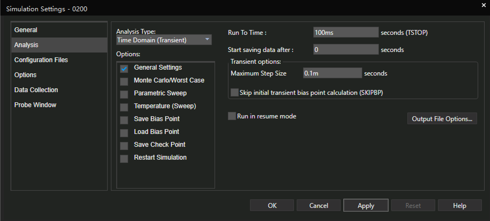 | Transient settings |
| 29 |  | C = 30 nF |
| 30 |  | C = 3 nF |
| 31 |  | C = 30 nF (repeat) |
| 32 |  | C = 300 nF |
| 33 | 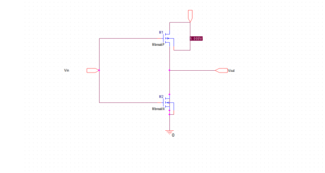 | Symbol-level schematic |
| 34 | 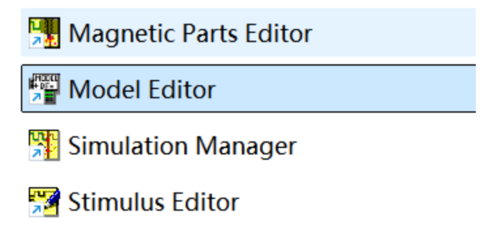 | Create Netlist dialog |
| 35 | 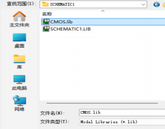 | Model Editor |
| 36 | 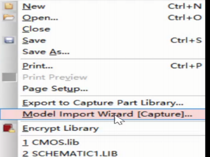 | Model Import Wizard |
| 37 | 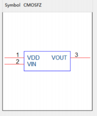 | Part symbol generated |
| 38 |  | `CMOS_FZ_TEST` wrapper |
| 39 |  | Packaged part VTC |
| 40 |  | Wrapper transient schematic |
| 41 |  | Wrapper transient result |

