# Project 03 — Verilog Design and Simulation of a 1-Bit Full Adder

> Source document: *实验三 全加器（Verilog）*
> Toolchain: Xilinx Vivado · Verilog-2001

---

## 1. Objective

Master the basic syntax of Verilog and the associated simulation methodology by designing, testing and synthesising a **1-bit full adder** — thereby walking through the complete digital IC design and verification flow.

## 2. Experiment specification

- Write a **1-bit binary full adder** in Verilog.
- Write a **testbench** that exercises the design.
- Verify functional correctness by analysing the **simulation waveform**.
- Synthesise the design and inspect the resulting **RTL schematic**.

---

## 3. Background

### 3.1 Logic function of a full adder

A full adder is the combinational circuit that adds two 1-bit operands together with the carry coming from the next-lower bit position.

| Port | Direction | Meaning |
|------|-----------|---------|
| `A` | input | addend |
| `B` | input | augend |
| `Cin` | input | carry-in from the lower bit |
| `Sum` | output | sum of this bit position |
| `Cout` | output | carry-out to the next-higher bit |

The arithmetic function is *S* = *A* + *B* + *Cin*, producing the local sum *S* and a carry *Cout* to the next stage. For example, *A* = 1, *B* = 1, *Cin* = 1 gives 1 + 1 + 1 = 3, i.e. *S* = 1 and *Cout* = 1.

Truth table:

| A | B | Cin | Sum | Cout |
|---|----|-----|-----|------|
| 0 | 0 | 0 | 0 | 0 |
| 0 | 0 | 1 | 1 | 0 |
| 0 | 1 | 0 | 1 | 0 |
| 0 | 1 | 1 | 0 | 1 |
| 1 | 0 | 0 | 1 | 0 |
| 1 | 0 | 1 | 0 | 1 |
| 1 | 1 | 0 | 0 | 1 |
| 1 | 1 | 1 | 1 | 1 |

### 3.2 Implementation styles available in Verilog

A full adder can be described at gate level (structural), at dataflow level (continuous assignments on Boolean equations) or behaviourally (procedural blocks). This experiment used the **dataflow** style, which maps directly onto the Boolean minimisation and is the most compact description for a purely combinational function:

```
Sum  = A ^ B ^ Cin
Cout = A·B + B·Cin + A·Cin
```

---

## 4. Method

The design was implemented in **Xilinx Vivado**.

1. **Create the project** — `Create Project`, name it, and choose a storage location.
2. **Select the project type** — `RTL Project`.
3. **Add source files** — existing design files may be imported here, or added later. An FPGA **device** was selected to match the available target board.
4. **Create the design source** — `+` → `Create Design Sources` → `Create File`, and name it `full_adder.v`.
5. **Create the simulation source** — the same procedure with `Create Simulation Sources`, to produce the testbench.
6. **Write the RTL** — open `full_adder` from Design Sources and enter the dataflow description.
7. **Write the testbench** — open the simulation source and enter the stimulus.
8. **Run the simulation** — right-click the simulation source → `Set as Top`, then `Run Simulation` from the Flow Navigator.
9. **Synthesise** — `Run Synthesis` in the Flow Navigator converts the HDL into a gate-level netlist, then `Open Synthesized Design ▸ Schematic` displays the inferred RTL circuit.

### 4.1 RTL source — `full_adder.v`

```verilog
module full_adder(
    input  A,
    input  B,
    input  Cin,
    output Sum,
    output Cout
);

    assign Sum  = A ^ B ^ Cin;
    assign Cout = (A & B) | (B & Cin) | (A & Cin);

endmodule
```

→ [`rtl/full_adder.v`](rtl/full_adder.v)

<p align="center">
  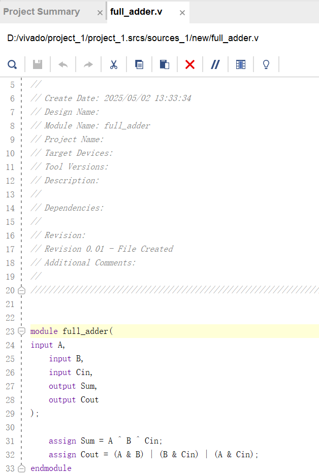
  <br><em><code>full_adder.v</code> in the Vivado editor.</em>
</p>

### 4.2 Testbench — `tb_full_adder.v`

The testbench instantiates the design under test and applies an **exhaustive** stimulus — all eight possible combinations of A, B and Cin, at 10 ns intervals — so that the whole truth table can be verified from a single waveform.

```verilog
module tb_full_adder;

    reg  A, B, Cin;
    wire Sum, Cout;

    full_adder uut (
        .A(A), .B(B), .Cin(Cin),
        .Sum(Sum), .Cout(Cout)
    );

    initial begin
        A = 0; B = 0; Cin = 0;  #10;
        A = 0; B = 1; Cin = 0;  #10;
        A = 0; B = 0; Cin = 1;  #10;
        A = 1; B = 1; Cin = 0;  #10;
        A = 1; B = 1; Cin = 1;  #10;
        A = 0; B = 1; Cin = 1;  #10;
        A = 1; B = 0; Cin = 1;  #10;
        A = 1; B = 0; Cin = 0;  #10;
        $stop;
    end

endmodule
```

→ [`tb/tb_full_adder.v`](tb/tb_full_adder.v)

<p align="center">
  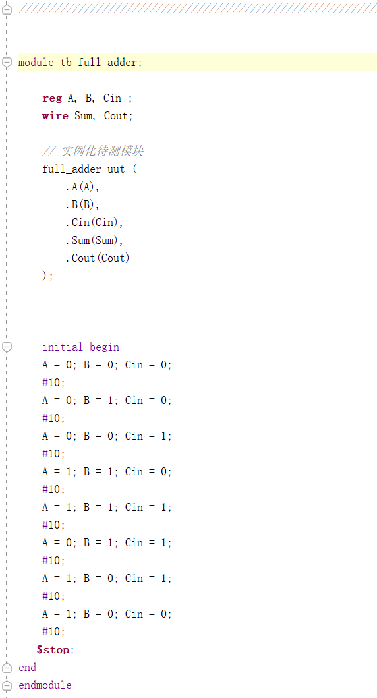
  <br><em>Testbench in the Vivado editor.</em>
</p>

---

## 5. Results

### 5.1 Simulation waveform

<p align="center">
  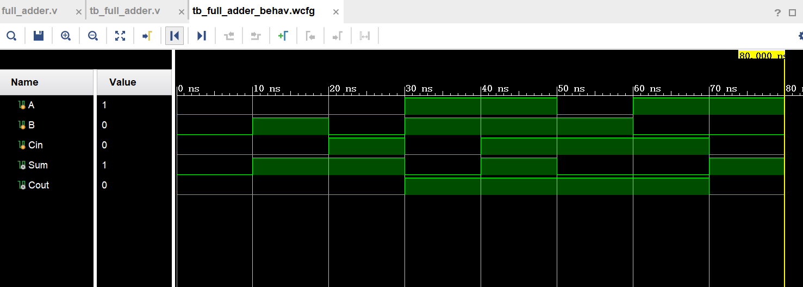
  <br><em>Behavioural simulation waveform for all eight input combinations.</em>
</p>

The waveform shows the rising and falling edges of `Sum` and `Cout` clearly enough for every vector to be read off directly. Comparing each 10 ns window against the truth table of §3.1 confirms that:

- `Sum` is high exactly when an **odd** number of the three inputs is high — the expected XOR behaviour.
- `Cout` is high exactly when **two or three** inputs are high — the expected majority function.

Every one of the eight combinations matches the reference truth table, so the design is functionally correct. Expanding the waveform (the four-arrow button in the top-left of the wave window) made the individual transitions easier to resolve:

<p align="center">
  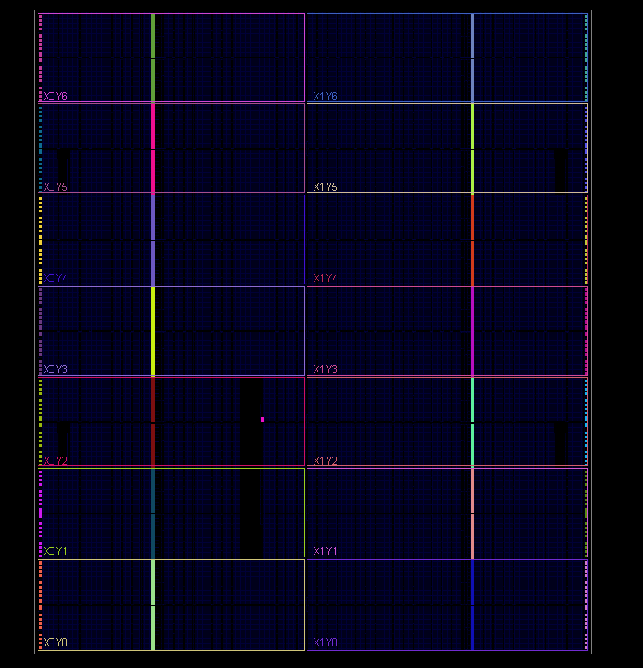
  <br><em>Waveform expanded for closer inspection.</em>
</p>
<p align="center">
  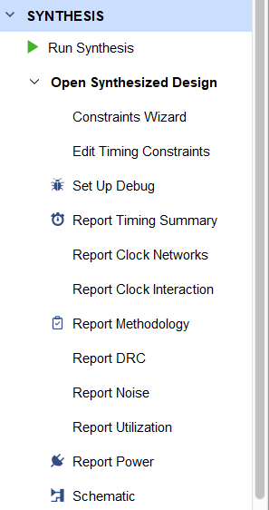
  <br><em>Detail view of the transitions.</em>
</p>

### 5.2 Synthesis and the inferred RTL circuit

`Run Synthesis` produced the gate-level netlist without errors. `Open Synthesized Design ▸ Schematic` then displayed the inferred structure:

<p align="center">
  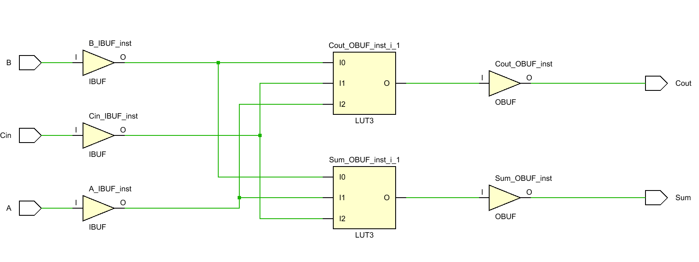
  <br><em>Synthesised (gate-level) implementation of the three-input full adder.</em>
</p>

The schematic contains two cascaded XOR gates for `Sum` and three AND terms combined by an OR gate for `Cout` — exactly the Boolean structure written in the source. This is the most useful practical outcome of the exercise: the synthesiser reflects the *equations*, so the conciseness of the source code directly determines the size of the inferred circuit.

---

## 6. Discussion

- **The idea-to-hardware bridge.** HDL is the bridge between a logic specification and hardware. Writing the expressions literally (rather than as an `if`-based behavioural description) makes the mapping from code to gates one-to-one, which is exactly what the RTL schematic shows.
- **Testbench completeness matters more than testbench length.** Eight vectors, each 10 ns apart, were enough to cover 100 % of the input space; an input space of this size should always be tested exhaustively rather than by sampling.
- **Modelling style is a design decision.** The comparison made in this project between gate-level and behavioural descriptions showed that the gate-level form is closer to the hardware but more verbose, whereas the behavioural form is far more maintainable. The right choice depends on whether the intent is to control the structure or to describe the function. For a fully specified combinational function like this one, the compact dataflow form wins.
- **Logic optimisation has a direct hardware payoff.** The `Cout` expression uses the classic three-term form; at this size a Karnaugh-map reduction of a redundant gate is possible, and in larger designs the same reasoning is what keeps gate count and critical-path delay down.
- **Simulation ideal ≠ reliable hardware.** During waveform debugging, jitter on the carry signal attributable to **gate delay** was visible. Ideal (zero-delay) simulation verifies *function*, not *timing*; making a circuit reliable in silicon requires timing constraints and static timing analysis — the natural next step after this project.

---

## 7. Note on the listings in this report

The Verilog listings above were transcribed line-by-line from the editor screenshots in the original submission. Lines that were cropped out of a screenshot (the file header comments in `full_adder.v` and the `timescale` / module-line region of the testbench) have been completed in the standard, unambiguous form.

---

## Appendix — full figure gallery

<details>
<summary><strong>Click to expand all 16 captures from this laboratory</strong></summary>

| # | Figure | Description |
|---|--------|-------------|
| 01 | 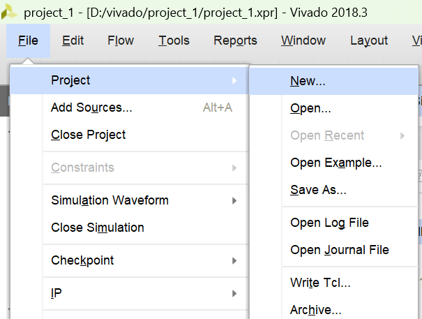 | Create project |
| 02 | 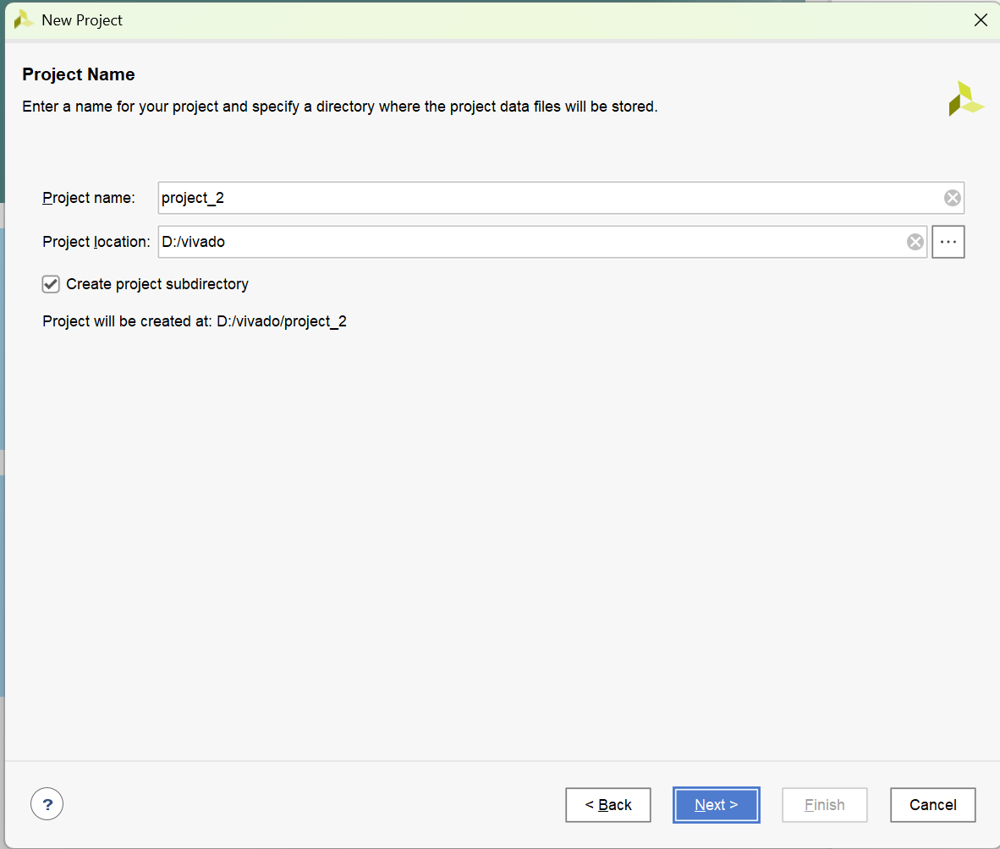 | Project name and location |
| 03 | 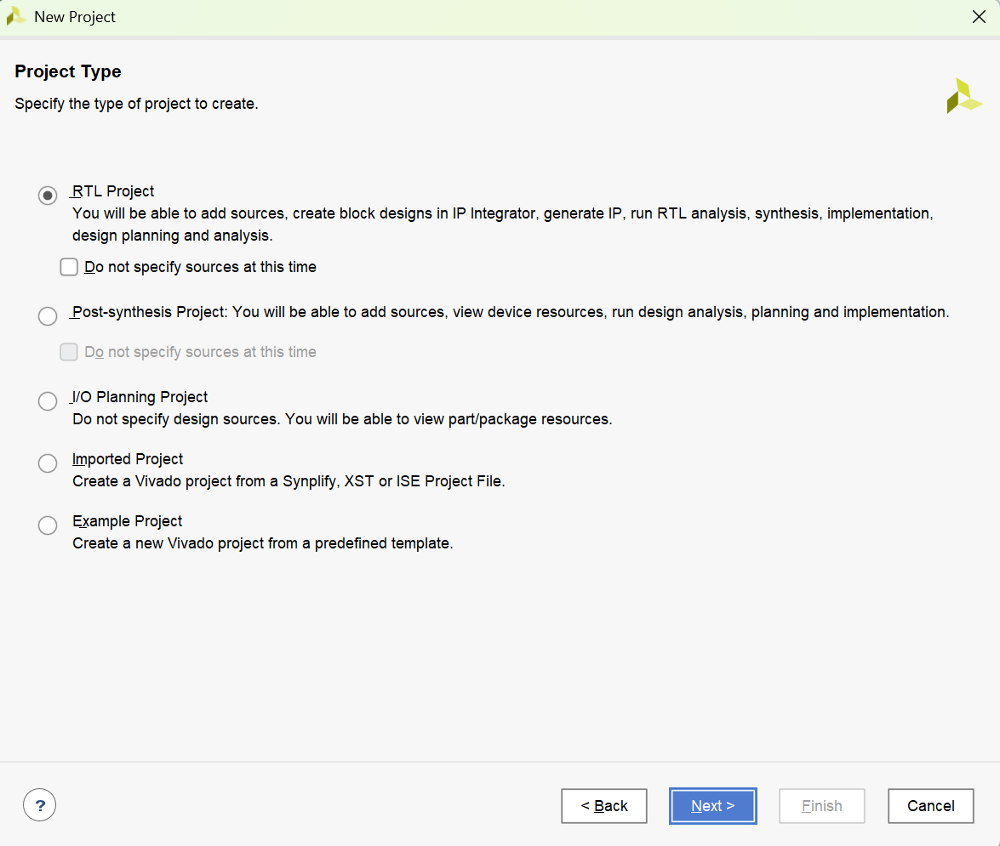 | RTL Project type |
| 04 | 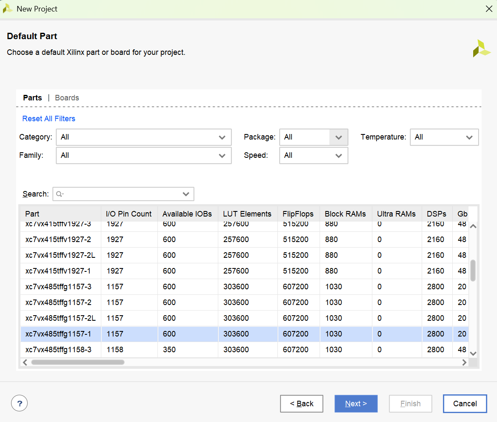 | FPGA device selection |
| 05 | 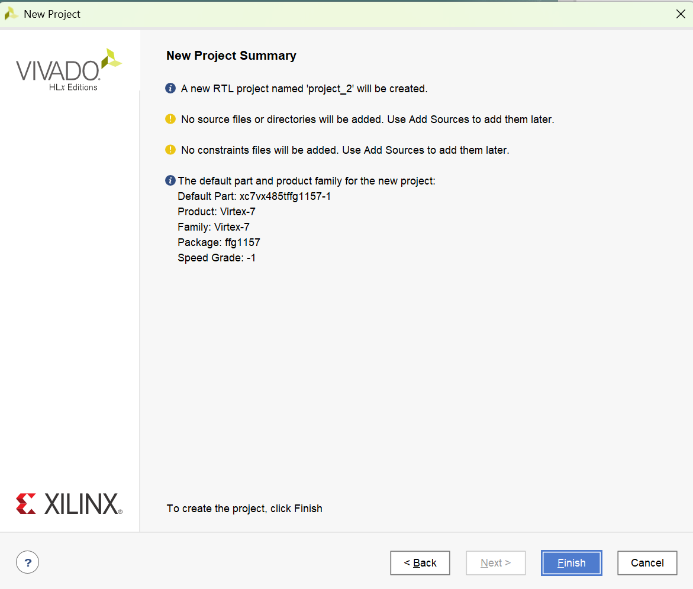 | Device list |
| 06 | 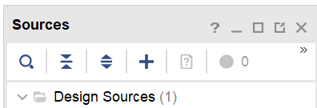 | Project summary / Finish |
| 07 | 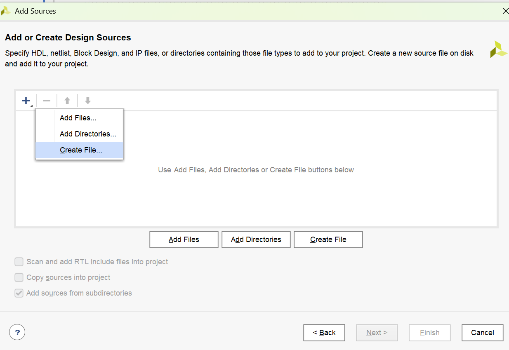 | Add Sources |
| 08 | 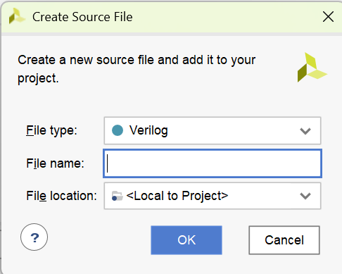 | Create design source |
| 09 | 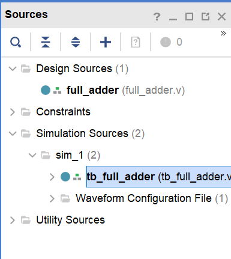 | Sources panel |
| 10 |  | `full_adder.v` |
| 11 |  | Testbench |
| 12 | 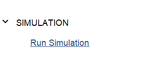 | Testbench (second view) |
| 13 |  | Simulation waveform |
| 14 |  | Waveform zoomed |
| 15 |  | Waveform detail |
| 16 |  | Synthesised RTL schematic |

</details>
