# Project 04 — Boolean Expression as a CMOS Compound Gate: Verilog and PSpice

> Source document: *实验四 Verilog & PSpice：布尔表达式*
> Toolchain: Xilinx Vivado + Cadence OrCAD Capture CIS / PSpice

---

## 1. Objective

Implement a simple Boolean expression as a logic circuit **two different ways** — once as RTL in Verilog, and once as a transistor-level **CMOS compound gate** drawn as a PSpice schematic — and show that both implementations realise the same function.

## 2. Experiment specification

The target expression (textbook reference, p. 158) is

<p align="center">
  <strong>F = NOT( A · (B + C) + D )</strong> &nbsp;&nbsp;— the bar is drawn over the entire right-hand side
</p>

<p align="center">
  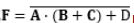
</p>

1. Implement the expression in Verilog and simulate it.
2. Design the corresponding **CMOS compound gate** using the PSpice schematic method and simulate it.

**Requirements:** write the Verilog description plus a testbench, verify correctness from the simulation waveform, then build the CMOS compound gate in Cadence OrCAD Capture and simulate it.

---

## 3. Background

### 3.1 The PSpice schematic method

PSpice's schematic flow is a graphical way of building a circuit model and simulating it with the SPICE kernel. It can be broken down into four layers:

1. **Schematic capture and device modelling** — the user draws the schematic in OrCAD Capture, dragging in devices (resistors, capacitors, transistors, …) and wiring nodes together.
2. **Automatic netlist generation and SPICE-kernel parsing** — Capture converts the graphical topology into a netlist.
3. **Analysis type and numerical processing** — the kernel stamps and solves the circuit equations.
4. **Convergence and error control.**

**Advantages of the schematic method**

| Property | Benefit |
|----------|---------|
| Intuitiveness | A graphical interface removes the complexity of hand-writing netlists |
| Automation | Topology, equation generation and numerical solution are handled automatically |
| Flexibility | Supports the full flow from a simple RC circuit to multi-level IC designs |
| Industrial standard | Model libraries and algorithms validated over decades; high confidence in the results |

### 3.2 Verilog implementation principle

The same expression can be described in Verilog at gate level, dataflow level or behavioural level. Because the expression is a single combinational function, a behavioural continuous assignment (`always @(*)`) is sufficient and maps directly onto the minimised Boolean form:

```
F = ~( A & (B | C) | D )
```

which is the De Morgan equivalent of an AND-OR-INVERT structure — i.e. exactly a **compound CMOS gate** (pull-up network and pull-down network) rather than a cascade of separate gates.

---

## 4. Part I — Verilog implementation and simulation (Vivado)

### 4.1 Project set-up

1. `Create Project` — name the project and choose a storage location.
2. Project type: **RTL Project** — the standard choice for Verilog/VHDL design; it allows design sources to be added later and supports the full synthesis/implementation flow.
3. Add source files — existing `.v` files may be imported now, or added afterwards via `Add Sources`.
4. Select the **FPGA device** matching the available board (through package / speed-grade filters).
5. `Finish`; then `+` → `Create Design Sources` → `Create File`, and likewise `Create Simulation Sources`.
6. Name the files, choose their location and confirm with **OK**.

### 4.2 RTL source — `boolean_logic.v`

```verilog
`timescale 1ns / 1ps

module boolean_logic(
    input      A,
    input      B,
    input      C,
    input      D,
    output reg F
);

    always @(*) begin
        F = ~( A & (B | C) | D );
    end

endmodule
```

→ [`rtl/boolean_logic.v`](rtl/boolean_logic.v)

<p align="center">
  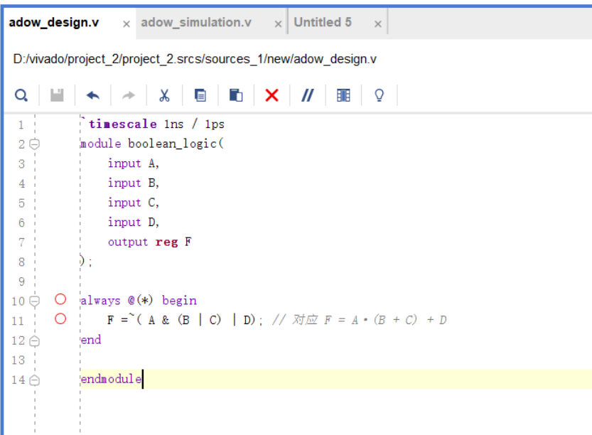
  <br><em><code>boolean_logic.v</code> in the Vivado editor.</em>
</p>

### 4.3 Testbench — `tb_boolean_logic.v`

A directed set of input vectors was applied, deliberately including the extreme cases (`0000`, `0100`, `1111`) that pin down the inverted-output behaviour:

```verilog
`timescale 1ns/1ps

module tb_boolean_logic;

    reg  A, B, C, D;
    wire F;

    boolean_logic uut (
        .A(A), .B(B), .C(C), .D(D), .F(F)
    );

    initial begin
        A=0; B=0; C=0; D=0; #10;
        A=0; B=0; C=0; D=1; #10;
        A=0; B=0; C=1; D=0; #10;
        A=0; B=0; C=1; D=1; #10;

        A=1; B=1; C=0; D=0; #10;
        A=1; B=1; C=0; D=1; #10;
        A=1; B=1; C=1; D=0; #10;
        A=1; B=1; C=1; D=1; #10;

        A=1; B=0; C=1; D=0; #10;
        A=1; B=0; C=1; D=1; #10;
        A=1; B=1; C=1; D=0; #10;
        A=1; B=1; C=1; D=1; #10;

        A=1; B=0; C=0; D=1; #10;
        A=1; B=0; C=1; D=1; #10;
        A=1; B=1; C=0; D=1; #10;
        A=1; B=1; C=1; D=1; #10;

        $finish;
    end

endmodule
```

→ [`tb/tb_boolean_logic.v`](tb/tb_boolean_logic.v)

<p align="center">
  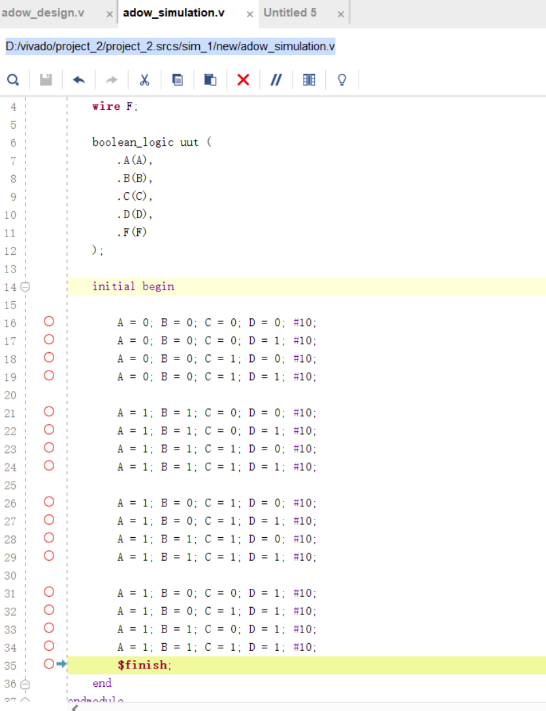
  <br><em>Testbench in the Vivado editor.</em>
</p>

### 4.4 Simulation and synthesis

`Set as Top` on the simulation source, then `Run Simulation` from the Flow Navigator.

<p align="center">
  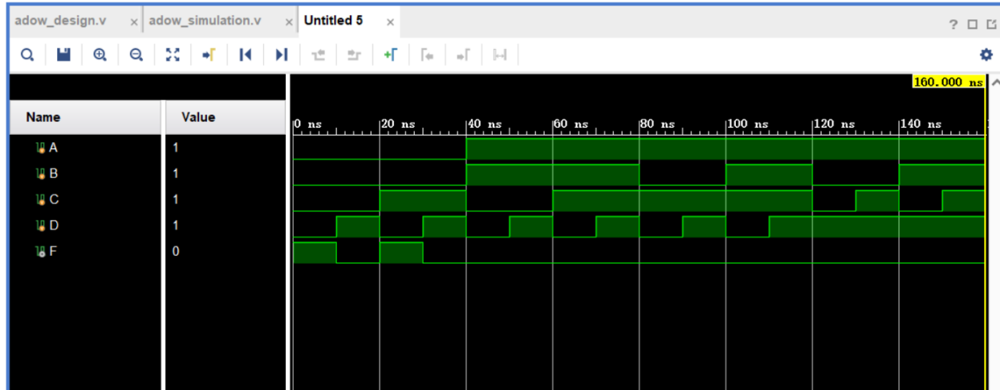
  <br><em>Simulation waveform of the Boolean function.</em>
</p>
<p align="center">
  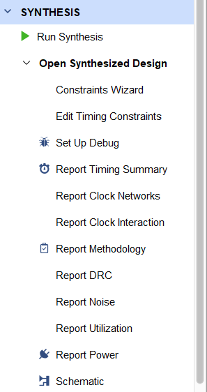
  <br><em>Expanded view of the waveform.</em>
</p>

Analysing the waveform confirms the expression. The two cases that fully characterise the function:

| A | B | C | D | A·(B+C) | A·(B+C)+D | **F (inverted)** |
|---|---|---|---|---------|-----------|------------------|
| 0 | 0 | 0 | 0 | 0 | 0 | **1** |
| 1 | 1 | 1 | 1 | 1 | 1 | **0** |

Whenever the inner term A·(B+C)+D evaluates to 0 the output F is high, and it falls to 0 as soon as any one of A (with B or C), or D alone, is asserted — the expected inverted compound-gate behaviour. A subsequent `Run Synthesis` and `Open Synthesized Design ▸ Schematic` produced the inferred circuit:

<p align="center">
  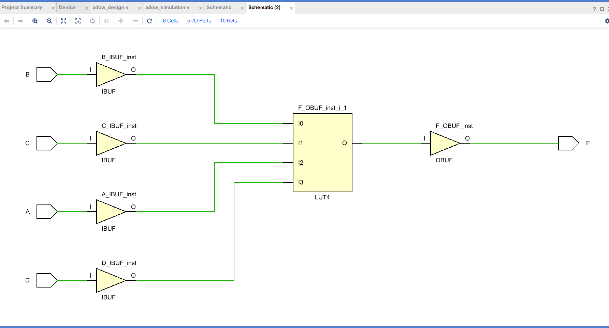
  <br><em>Synthesised circuit for <code>F = ~(A·(B+C) + D)</code>.</em>
</p>

The synthesiser implements the inverted AND-OR term directly, which is why the CMOS pull-up / pull-down structure of Part II is the natural transistor-level counterpart of the same equation.

---

## 5. Part II — CMOS compound gate in PSpice

### 5.1 Building the schematic

A new PSpice project was created (blank project). The circuit was drawn from the complementary **CMOS compound-gate** reference topology:

- From the `SOURCE` library: a **`VDC`** d.c. voltage source and **`VAC`** a.c. sources.
- **The four `VAC` sources were staggered so that each successive source has half the `PW`/`PER` of the previous one, and each source's `PW`/`PER` ratio is exactly one half** — this produces four signals with different frequencies, so that the four operands A, B, C, D change at visibly different rates in the transient plot.
- From the `BREAKOUT` library: **`MbreakN`** (N-type) and **`MbreakP`** (P-type) transistors.

<p align="center">
  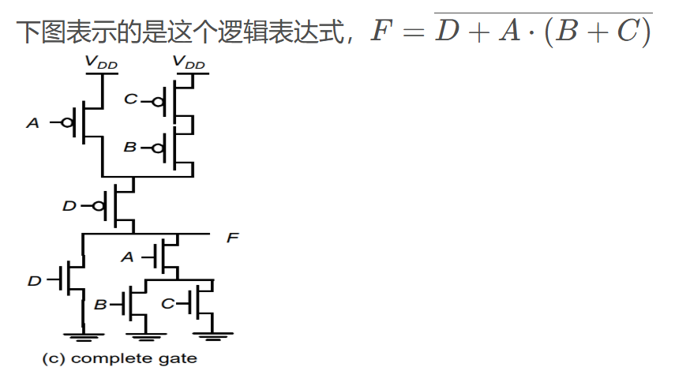
  <br><em>Reference complementary CMOS compound-gate topology.</em>
</p>
<p align="center">
  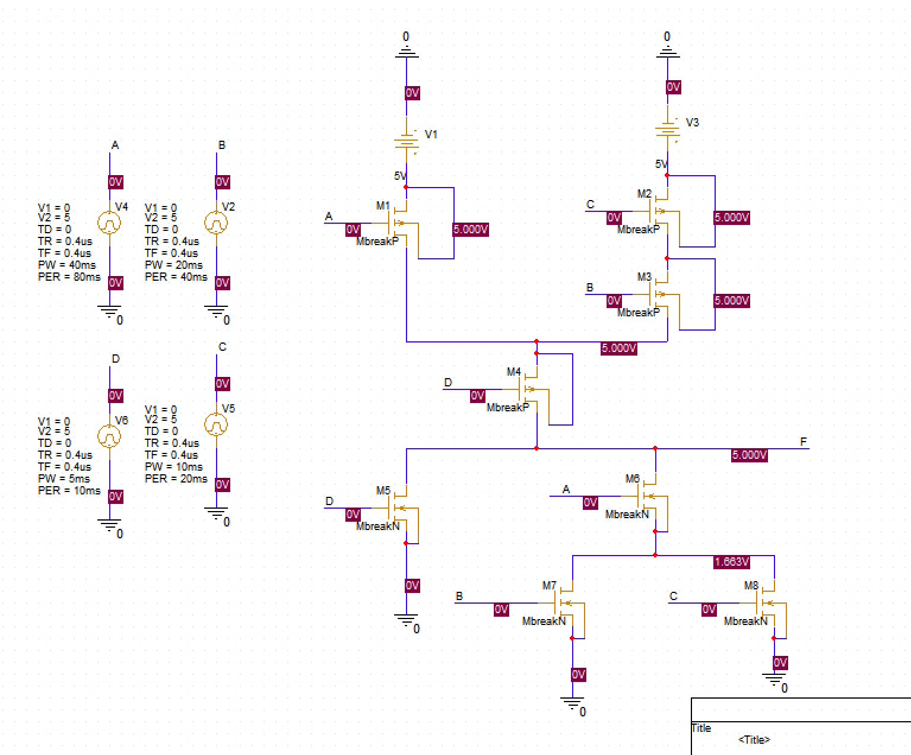
  <br><em>Schematic of the compound gate: pull-up P-network over pull-down N-network, driven by A, B, C, D.</em>
</p>

### 5.2 Simulation

A new simulation profile with **transient analysis** was created and the parameters below were entered.

| Step | Figure |
|------|--------|
| New simulation profile | [fig-21](figures/fig-21-new-simulation-profile.png) |
| Profile name | [fig-22](figures/fig-22-simulation-profile-name.png) |
| Transient analysis settings | [fig-23](figures/fig-23-transient-settings.png) |
| Running PSpice | [fig-24](figures/fig-24-run-pspice.png) |
| `Trace ▸ Add Trace` | [fig-25](figures/fig-25-add-trace.png) |
| Selecting `V(A)` | [fig-26](figures/fig-26-select-va.png) |

### 5.3 Results

`V(A)` alone, plotted first:

<p align="center">
  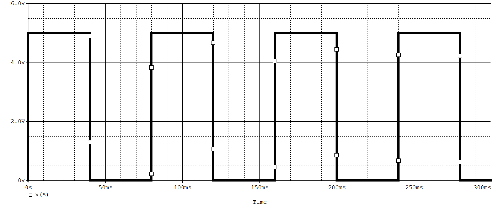
  <br><em>Waveform of input A.</em>
</p>

Then multiple traces were added to the same window to show `V(A)`, `V(B)`, `V(C)`, `V(D)` together with the output `V(F)`:

<p align="center">
  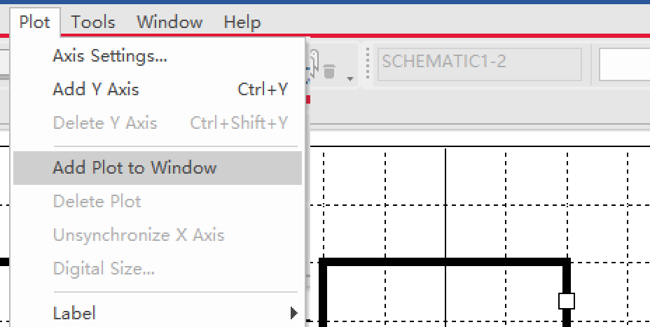
  <br><em>Adding the remaining traces.</em>
</p>
<p align="center">
  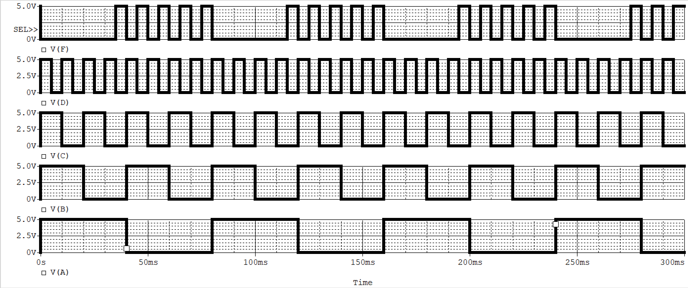
  <br><em>Inputs B, C, D and the output F.</em>
</p>

Because the four inputs are driven at successively halved pulse widths, the input vectors sweep through many combinations within the simulated interval. The output `V(F)` goes low only in the intervals where the series path A·(B+C) conducts or where D alone is high, and is high everywhere else — that is, the transistor network reproduces the inverted compound function `F = ~(A·(B+C) + D)` that was written in Verilog in Part I.

---

## 6. Discussion

- **One equation, two very different implementation paths.** The Verilog dataflow form and the transistor-level compound gate are separated by the whole synthesis stack, yet both are direct consequences of the same De Morgan transformation. Seeing the P-network / N-network duality against the synthesised schematic makes the CMOS *static* design style (complementary pull-up and pull-down) concrete rather than abstract.
- **PSpice is a tool that has to be learned before it can be used.** The main difficulties in Part II were tool-related rather than circuit-related: not knowing how to enter device parameters meant the circuit initially produced nothing meaningful. Recovering from that required systematically re-checking each device and assumption — which is the same debugging discipline required for RTL.
- **Stimulus design is part of the experiment.** Making the four `VAC` sources successively halve their pulse width was what made a single transient run show a large part of the input space, mirroring the role of a well-designed testbench in Part I.
- **Two tools, one verification idea.** Vivado verifies function against a truth table; PSpice verifies the electrical realisation against time-domain waveforms. The value of doing both is that a functional error and an electrical/topological error are distinguishable — a circuit can be logically correct and still fail electrically, and vice versa.
- **Teamwork.** Splitting the work — one member writing the code while the other reviewed the logic and syntax, then jointly reviewing the schematic structure and device parameters — noticeably improved both throughput and the number of problems caught before simulation.

---

## 7. Note on the listings in this report

The Verilog listings were transcribed line-by-line from the editor screenshots in the original submission. The header region of the testbench (`timescale` directive and module declaration) was cropped out of the screenshot and has been completed in the standard form.

---

## Appendix — full figure gallery

<details>
<summary><strong>Click to expand all 29 captures from this laboratory</strong></summary>

| # | Figure | Description |
|---|--------|-------------|
| 01 |  | Target Boolean expression |
| 02 | 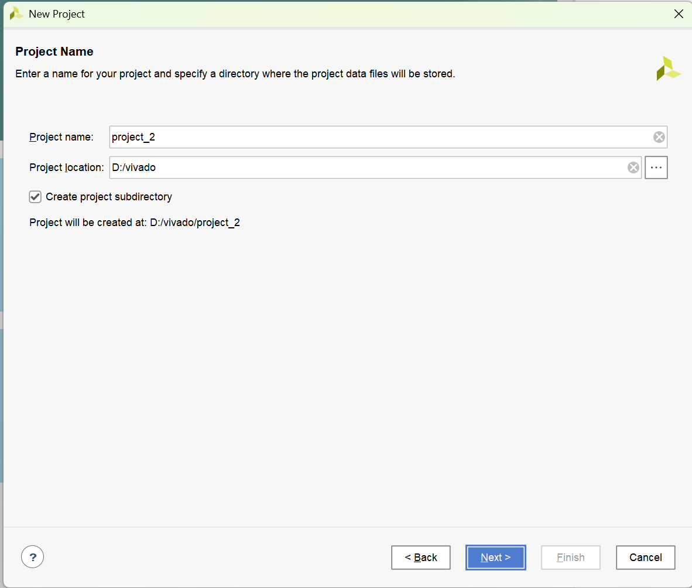 | Project name |
| 03 | 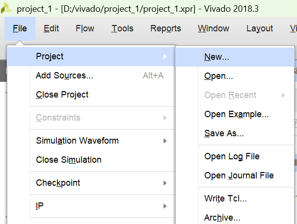 | Project path |
| 04 | 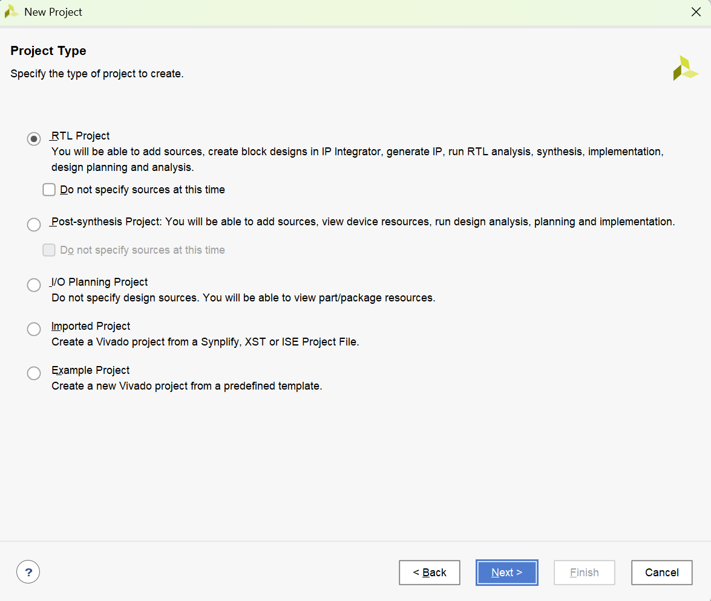 | RTL project type |
| 05 | 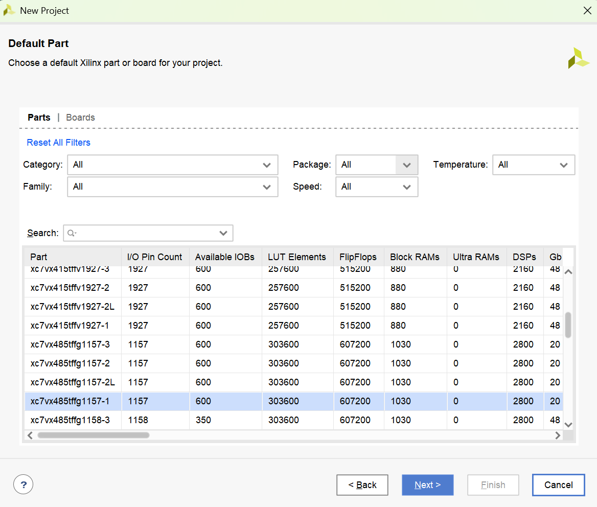 | Add sources |
| 06 | 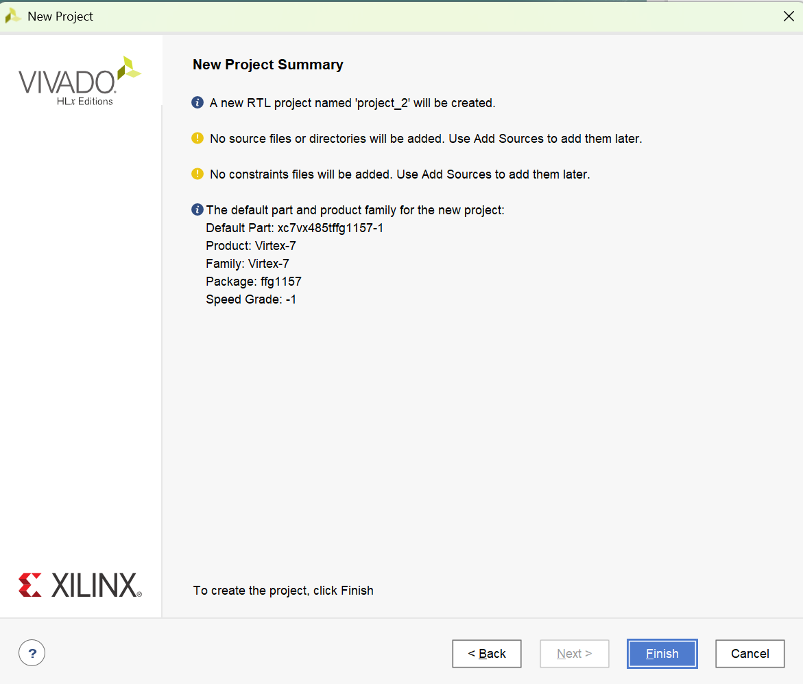 | FPGA device |
| 07 |  | Project summary |
| 08 | 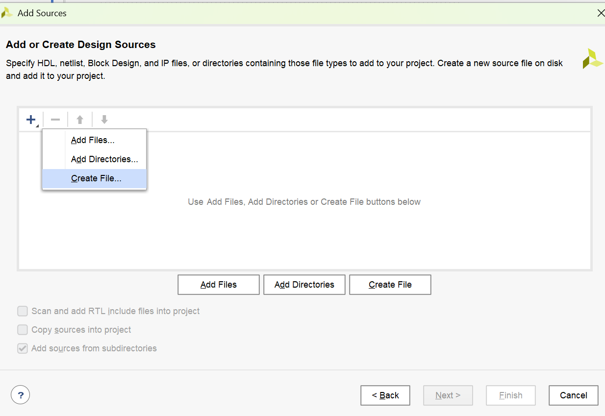 | Create design source |
| 09 | 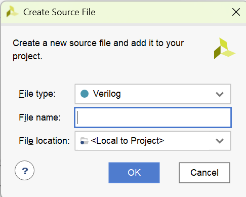 | Sources panel |
| 10 | 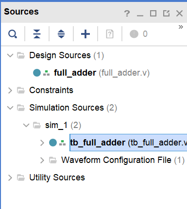 | Design sources |
| 11 |  | `boolean_logic.v` |
| 12 |  | Testbench |
| 13 |  | Run Simulation |
| 14 |  | Simulation waveform |
| 15 |  | Waveform detail |
| 16 |  | RTL schematic |
| 17 | 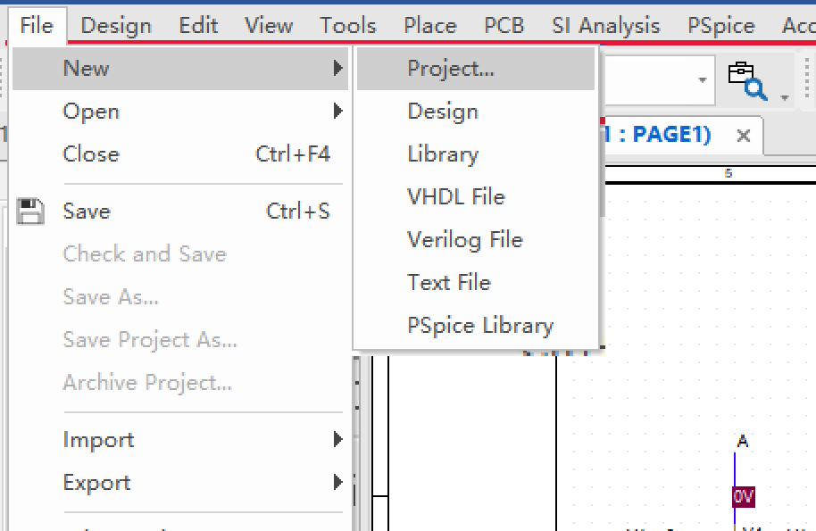 | New PSpice project |
| 18 | 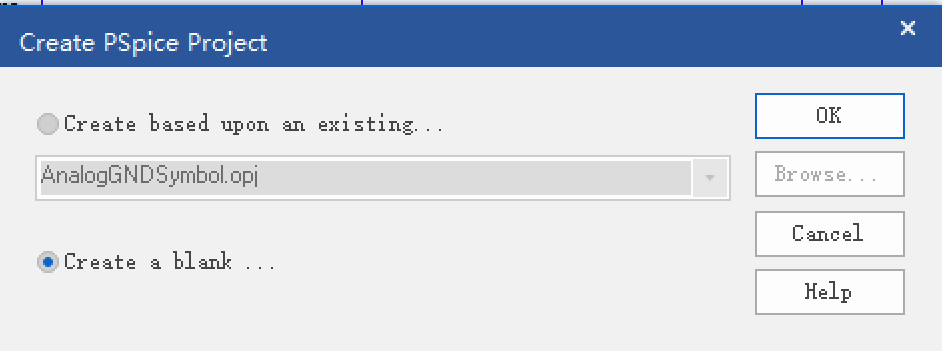 | Blank project |
| 19 |  | CMOS compound-gate reference |
| 20 |  | PSpice schematic |
| 21 | 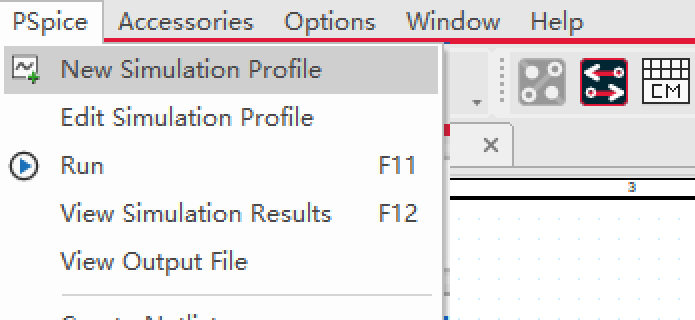 | New simulation profile |
| 22 | 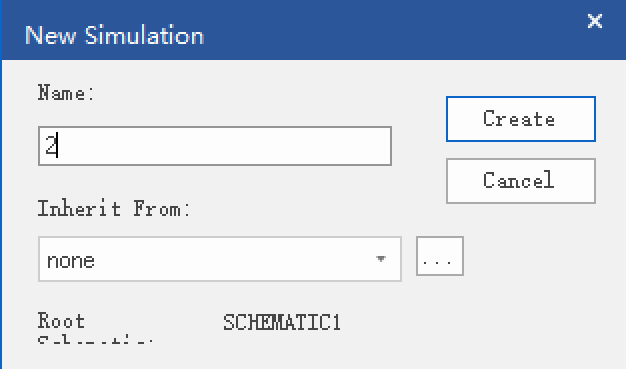 | Profile name |
| 23 | 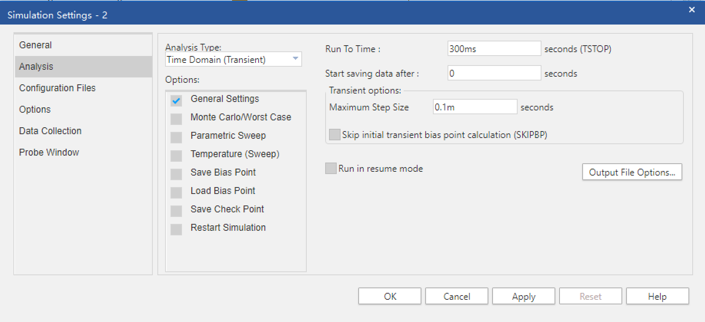 | Transient settings |
| 24 | 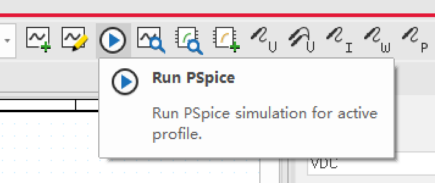 | Running PSpice |
| 25 | 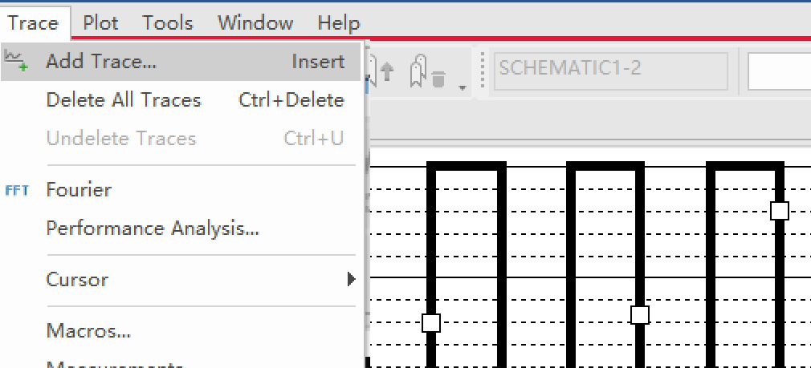 | Add Trace |
| 26 | 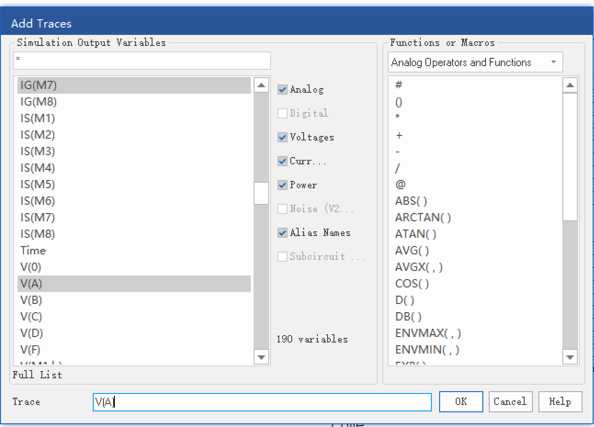 | Selecting V(A) |
| 27 |  | V(A) waveform |
| 28 |  | Multiple plots |
| 29 |  | V(B)…V(F) waveforms |

</details>
