# Project 05 — Traffic-Light Controller: Verilog FSM Design and Simulation

> Source document: *实验五 Verilog 编程：红绿灯*
> Toolchain: Xilinx Vivado · Verilog-2001

---

## 1. Objective

Design a **traffic-light control circuit** in Verilog and verify it by simulation.

## 2. Experiment specification

Design a minimal crossroads traffic-light controller. The crossroads is described by the four compass directions East, South, West and North, where **East and West always show the same state**, and **North and South always show the same state**. The state sequence over time is specified as follows:

<p align="center">
  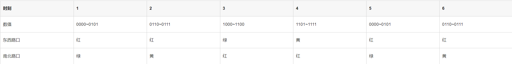
  <br><em>Required state sequence. (Counter values are 4-bit; states 5 and 6 repeat states 1 and 2, closing the cycle.)</em>
</p>

| Phase | 1 | 2 | 3 | 4 | 5 | 6 |
|-------|---|---|---|---|---|---|
| Counter | 0000–0101 | 0110–0111 | 1000–1100 | 1101–1111 | 0000–0101 | 0110–0111 |
| East–West | Red | Red | **Green** | **Yellow** | Red | Red |
| North–South | **Green** | **Yellow** | Red | Red | **Green** | **Yellow** |

Write the corresponding Verilog program and simulate it. A testbench must be written and correctness verified by analysing the simulation waveform.

---

## 3. Background

### 3.1 Finite-state-machine principle

A traffic-light controller is fundamentally a **finite-state machine**: the system decides the next state from the current state and the input (here, elapsed time).

The specification table shows **six principal phases**, each mapped to a specific lamp combination.

### 3.2 Time-counting control

A **4-bit binary counter (0000–1111)** tracks time. Each counting range corresponds to one phase:

| Counter range | Phase |
|---------------|-------|
| 0000–0101 (0–5) | 1 / 5 |
| 0110–0111 (6–7) | 2 / 6 |
| 1000–1100 (8–12) | 3 |
| 1101–1111 (13–15) | 4 |

### 3.3 Lamp control logic

The East–West and North–South lamp states are **complementary**: whenever one direction is green the other must be red. **Yellow** acts as the transition state that follows the end of a green period.

### 3.4 Synchronisation and recycling

After a full cycle (phases 1–6) the machine automatically wraps back to phase 1. The duration of each phase is determined by its counter range.

---

## 4. Method

The design was implemented in **Xilinx Vivado**.

1. `Create Project`, name it, and choose the storage location.
2. Project type: **RTL Project** — the standard register-transfer-level project type, suitable for anything from basic combinational logic to complex sequential systems, and the option that permits later synthesis and implementation.
3. Add source files: existing Verilog/VHDL files (`.v`, `.vhd`) may be imported immediately, or added at any time afterwards through `Add Sources`.
4. Select the **FPGA device** — filtered by package and speed grade to match the actual development board (e.g. Xilinx Artix-7 or Zynq-7000).
5. `Finish`.
6. `+` → `Create Design Sources` → `Create File`, giving the file a name such as `traffic_light.v`, a file type and a path. The new file is added to the Design Sources group automatically.
7. Repeat for `Create Simulation Sources`; the final source tree is shown below.
8. Double-click the design source to open the editor and enter the RTL.
9. Open the simulation source and enter the testbench.
10. Right-click the simulation source → `Set as Top`, then `Run Simulation` from the Flow Navigator. This uses the testbench as the simulation entry point, invokes the built-in simulator for RTL functional verification, and displays the waveform window and simulation report on completion.
11. Inspect the resulting waveform. The four-arrow button in the corner expands the view.
12. `Run Synthesis` in the Flow Navigator converts the HDL into a gate-level netlist.
13. `Open Synthesized Design ▸ Schematic` displays the inferred RTL circuit.

### 4.1 RTL source — `traffic_light.v`

```verilog
module traffic_light(
    input             clk,
    input             rst_n,
    output reg [2:0]  light_ew,   // East-West   {Red, Yellow, Green}
    output reg [2:0]  light_ns    // North-South {Red, Yellow, Green}
);

    reg [3:0] counter;            // 16-state free-running counter

    // Counter control logic
    always @(posedge clk or negedge rst_n) begin
        if (!rst_n) begin
            counter <= 4'b0;
        end else begin
            counter <= (counter == 4'b1111) ? 4'b0 : counter + 1;
        end
    end

    // Traffic-light state control (combinational decoding of the counter)
    always @(*) begin
        light_ew = 3'b000;        // default: all lamps off
        light_ns = 3'b000;

        case (1'b1)
            // Phase 1, counter 0-5 (6 cycles): EW red, NS green
            (counter <= 4'b0101): begin
                light_ew[0] = 1'b1;   // East-West red
                light_ns[2] = 1'b1;   // North-South green
            end
            // Phase 2, counter 6-7 (2 cycles): EW red, NS yellow
            (counter <= 4'b0111): begin
                light_ew[0] = 1'b1;   // East-West red
                light_ns[1] = 1'b1;   // North-South yellow
            end
            // Phase 3, counter 8-12 (5 cycles): EW green, NS red
            (counter <= 4'b1100): begin
                light_ew[2] = 1'b1;   // East-West green
                light_ns[0] = 1'b1;   // North-South red
            end
            // Phase 4, counter 13-15 (3 cycles): EW yellow, NS red
            default: begin
                light_ew[1] = 1'b1;   // East-West yellow
                light_ns[0] = 1'b1;   // North-South red
            end
        endcase
    end

endmodule
```

→ [`rtl/traffic_light.v`](rtl/traffic_light.v)

<p align="center">
  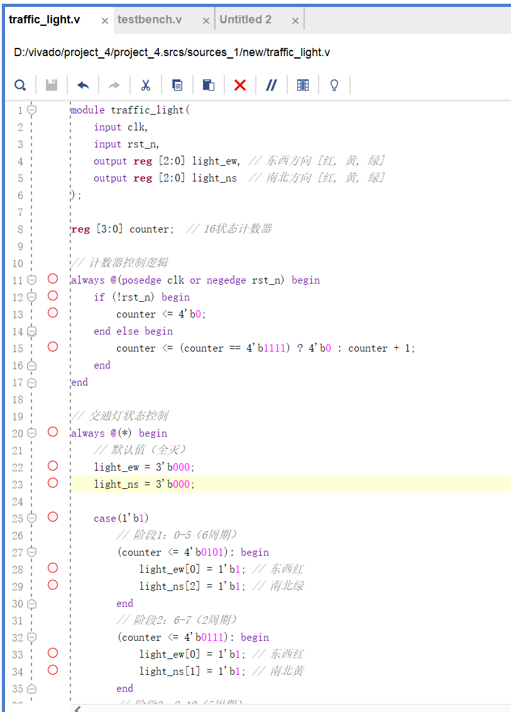
  <br><em><code>traffic_light.v</code> in the Vivado editor.</em>
</p>

### 4.2 Testbench — `tb_traffic_light.v`

```verilog
`timescale 1ns/1ps

module tb_traffic_light;

    reg        clk;
    reg        rst_n;
    wire [2:0] light_ew, light_ns;

    traffic_light dut (
        .clk(clk),
        .rst_n(rst_n),
        .light_ew(light_ew),
        .light_ns(light_ns)
    );

    // Clock generation (100 MHz)
    initial begin
        clk = 0;
        forever #5 clk = ~clk;
    end

    // Stimulus: reset, then run two complete cycles (32 clock periods)
    initial begin
        rst_n = 0;
        #20 rst_n = 1;
        #320 $finish;
    end

    // Waveform dump
    initial begin
        $dumpfile("wave.vcd");
        $dumpvars(0, tb_traffic_light);
    end

endmodule
```

→ [`tb/tb_traffic_light.v`](tb/tb_traffic_light.v)

<p align="center">
  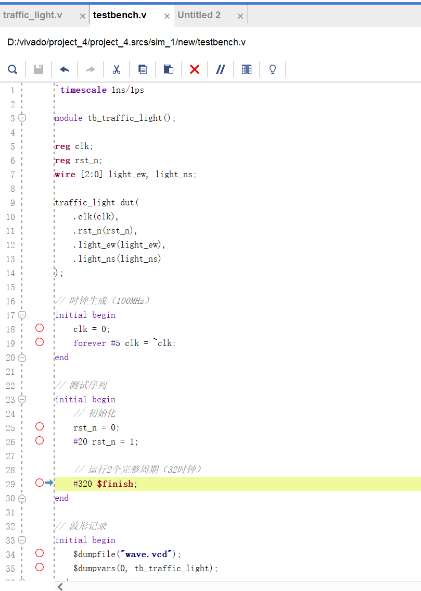
  <br><em>Testbench in the Vivado editor.</em>
</p>

---

## 5. Results

### 5.1 Simulation waveform

<p align="center">
  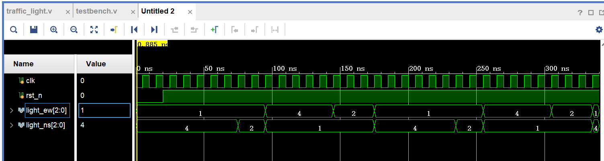
  <br><em>Behavioural simulation waveform — two complete 16-count cycles.</em>
</p>

Reading the waveform against the specification table:

- `light_ew[0]` (red) is asserted for counter values 0–7: 6 cycles in phase 1 plus 2 cycles in phase 2 — matching the table.
- `light_ns[2]` (green) is asserted only for counter values 0–5, i.e. exactly phase 1.
- `light_ns[1]` (yellow) is asserted for counter values 6–7, i.e. exactly phase 2.
- For counter values 8–12 the state swaps: `light_ew[2]` (green) and `light_ns[0]` (red).
- For counter values 13–15: `light_ew[1]` (yellow) and `light_ns[0]` (red).
- At counter = 15 the counter wraps to 0 and the sequence restarts, so the machine recycles correctly.

Every phase boundary in the waveform lines up with the specified counter range, so the controller is functionally correct.

### 5.2 Synthesis and resource utilisation

`Run Synthesis` completed and `Open Synthesized Design ▸ Schematic` displayed the inferred circuit:

<p align="center">
  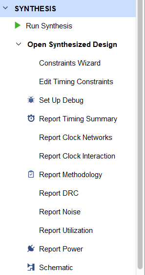
  <br><em>Synthesised structure of the controller.</em>
</p>
<p align="center">
  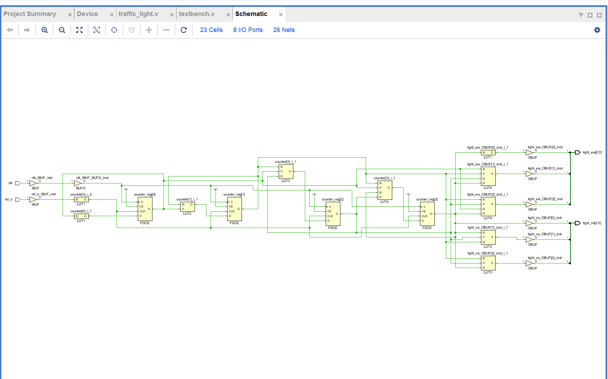
  <br><em>RTL (gate-level) view — the 4-bit counter plus the comparator/decoder network.</em>
</p>

The design occupies only a small number of logic cells, which is a useful data point in itself: the same functional requirement implemented as a *flattened* decode (many independent comparators) would occupy considerably more area than the counter-plus-shared-decoder structure used here.

---

## 6. Discussion

- **An FSM is the natural decomposition for timed control.** Once the six phases were identified, the messy "which lamp when" problem reduced to a table of counter ranges. Writing the counter range rather than the exact value (`counter <= 4'b0101` rather than an equality chain) is what keeps the decode logic compact.
- **Boundary conditions are where the bugs live.** The main implementation difficulty was defining the counter ranges precisely; an off-by-one in a range boundary makes the state change one cycle early or late and the whole cycle slips. This is where the simulation waveform earns its place — the error is visible immediately, whereas in hardware it would appear as a subtle timing fault.
- **Waveform-based debugging.** During development a case was observed in which the East–West lamps failed to switch, and tracing the waveform showed that one comparison expression in the state machine had been written incorrectly. Correcting the expression and re-simulating fixed it. Simulation therefore shortens the debug loop substantially.
- **Modularity pays off.** Structuring the design as counter + state machine + output logic makes each piece independently readable and independently replaceable. Extending the controller (e.g. an emergency all-red mode, or pedestrian phases) means editing one module rather than rewriting the system.
- **Resource awareness.** Inspecting the synthesis schematic and utilisation report gave the first practical feel for FPGA resources: the circuit is tiny, but the exercise makes clear that functional growth consumes resources roughly linearly, so resource-conscious coding has to start early.

---

## 7. Note on the listings in this report

The listings were transcribed line-by-line from the editor screenshots in the original submission. The screenshot of `traffic_light.v` was cropped after the first two branches of the `case` statement; the remaining two branches (phase 3 and phase 4) have been reconstructed directly from the state table in §2 — the reconstruction is shown in the `Phase 3` / `Phase 4` comments of the listing. The testbench header was transcribed in full.

---

## Appendix — full figure gallery

<details>
<summary><strong>Click to expand all 16 captures from this laboratory</strong></summary>

| # | Figure | Description |
|---|--------|-------------|
| 01 |  | Required state sequence |
| 02 | 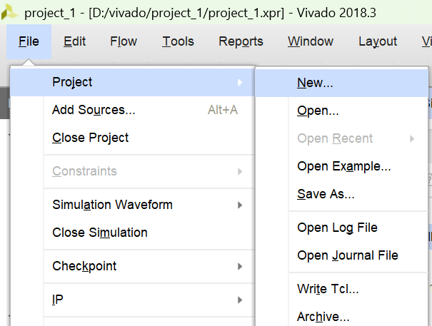 | Create project |
| 03 | 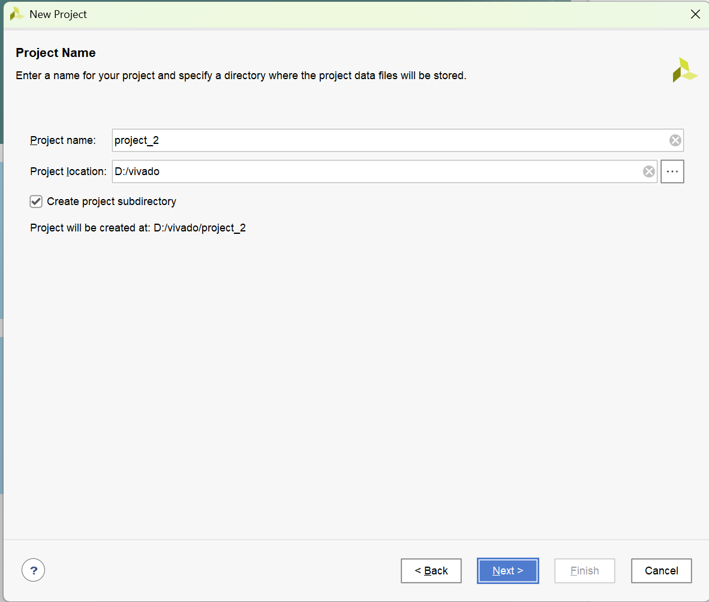 | Project path |
| 04 | 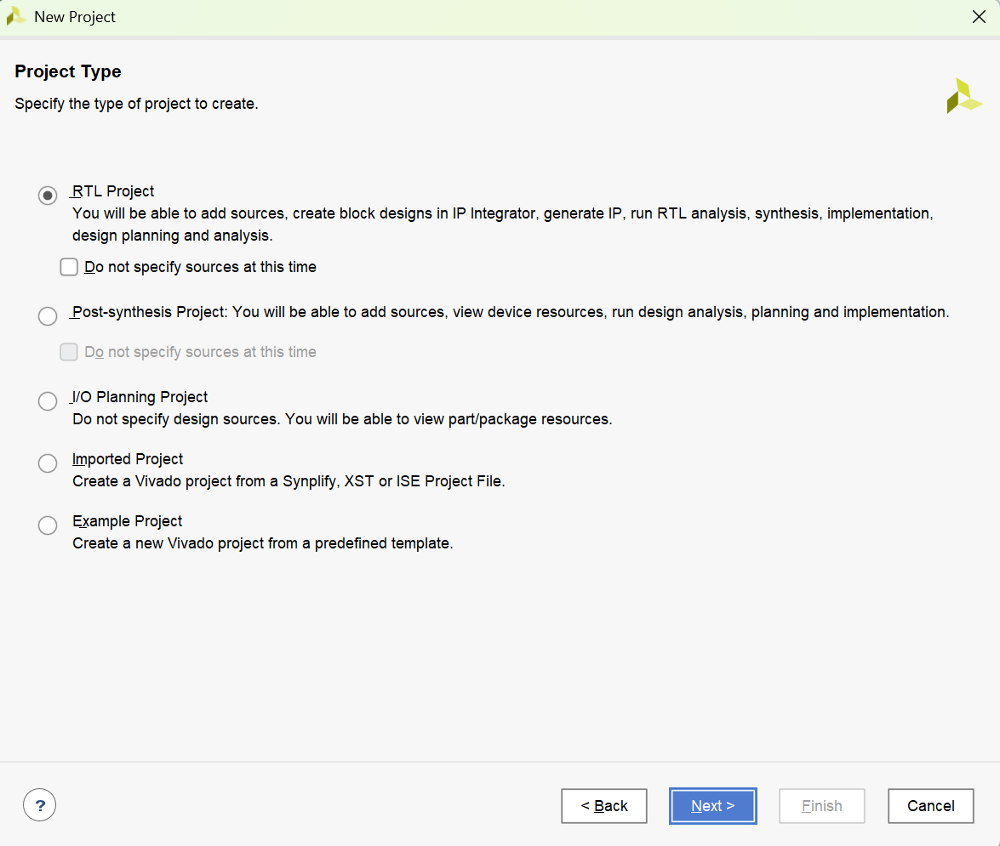 | RTL project type |
| 05 | 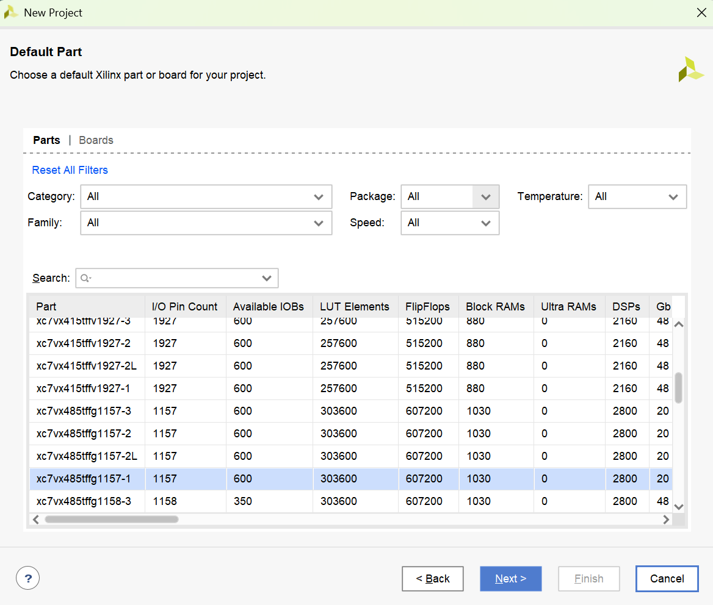 | FPGA device |
| 06 | 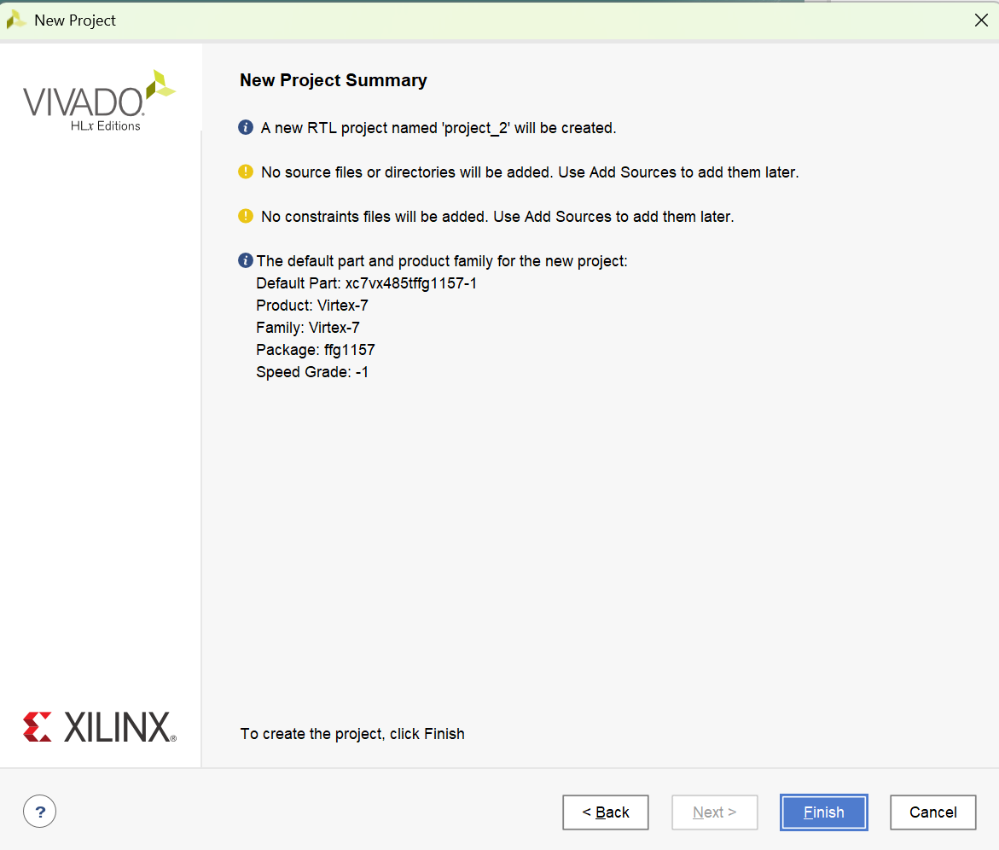 | Project summary |
| 07 | 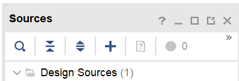 | Add sources |
| 08 | 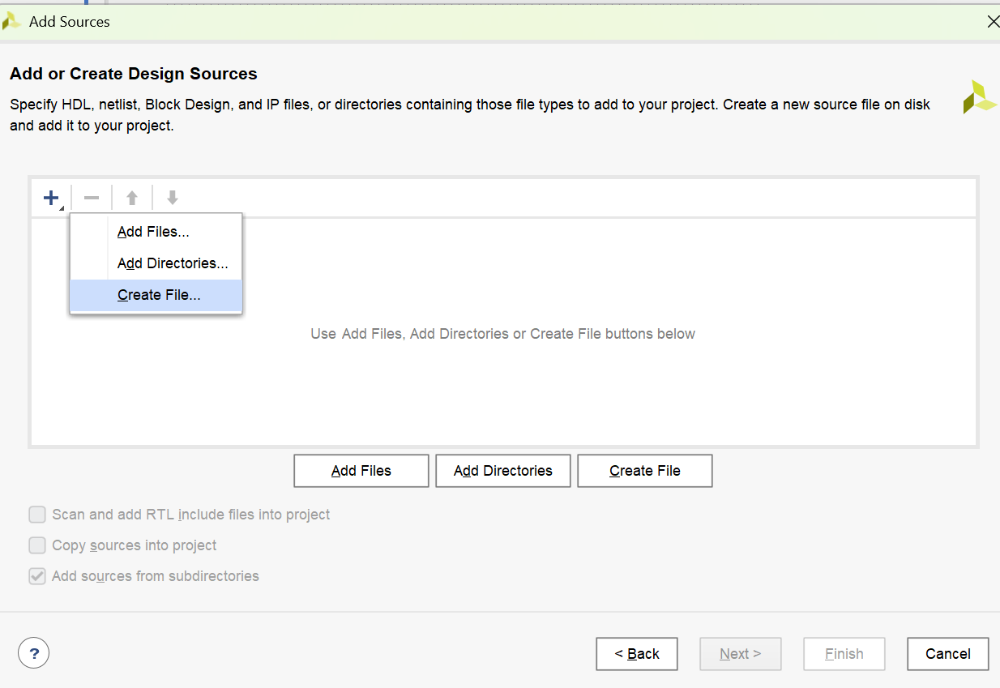 | Create design source |
| 09 | 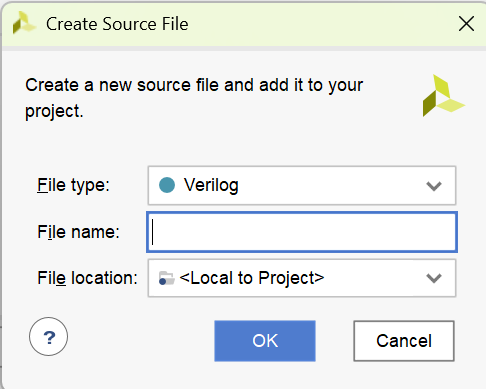 | Sources panel |
| 10 | 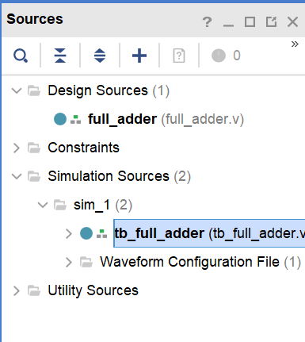 | Design sources |
| 11 |  | `traffic_light.v` |
| 12 |  | Testbench |
| 13 | 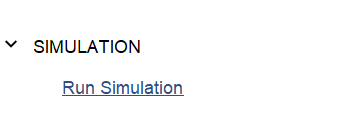 | Run Simulation |
| 14 |  | Simulation waveform |
| 15 |  | Synthesised schematic |
| 16 |  | RTL schematic |

</details>
