# Project 06 — PWM "Aria" Tone Generator: Verilog Design and Simulation

> Source document: *实验六 Verilog 编程：咏叹调（变音器）*
> Toolchain: Xilinx Vivado · Verilog-2001

---

## 1. Objective

Design a **tone generator ("aria" unit)** in Verilog whose loudness rises and falls over time — a swell-and-fade envelope applied to a buzzer.

## 2. Experiment specification

Design a sound generator whose volume varies with time.

### 2.1 Required effect

Sound swells from silence to maximum loudness, then fades from maximum back to silence — repeatedly, like an aria.

### 2.2 Principle

The sound pressure produced by a buzzer is proportional to the control current through it. At a fixed drive frequency:

- **duty cycle = 0 %** → the buzzer is silent;
- **duty cycle = 100 %** → the buzzer is at full power, i.e. loudest.

If the duty cycle is swept gradually from 0 % up to 100 %, and then back down from 100 % to 0 %, the buzzer produces the "aria" swell-and-fade effect. This is therefore a **PWM envelope generator**.

### 2.3 Design requirements

| Requirement | Value |
|-------------|-------|
| Clock frequency | **5 kHz** (period 0.2 ms) |
| Volume increase | **2 s** |
| Hold at maximum | **1 s** |
| Volume decrease | **2 s** |
| Hold at silence | **1 s** |
| Repetition | Continuous, forever |
| Loudness levels | **11 steps** — 0 %, 10 %, 20 %, …, 90 %, 100 % |
| Step duration | 2 s split into 10 parts → **0.2 s per step** |
| PWM frequency | Free choice |

The complete envelope therefore lasts 2 + 1 + 2 + 1 = **6 s** per cycle.

---

## 3. Method

### 3.1 Project set-up

`Create Project` was used to launch the wizard, then the project was named (a descriptive name) and a storage directory chosen on a drive with sufficient space. Project type: **RTL Project**. Design sources were created through `+` → `Create Design Sources` → `Create File`, giving `pwm_sound_controller.v`; the simulation source was created by the same route. Finally `Finish` completed the empty project.

### 3.2 Architecture

The design splits into two independent blocks, which is what keeps the timing budget explicit:

| Block | Function |
|-------|----------|
| **Envelope state machine** | Divides the 5 kHz clock down to a **200 ms** tick, and on each tick advances one of four states: ramp up → hold high → ramp down → hold low |
| **PWM generator** | A 10-step counter compares against `duty_step` and drives `pwm_out` |

Key timing calculation: at 5 kHz the clock period is 0.2 ms, so one 200 ms step is **1000 clock cycles** (`STEP_CYCLES = 1000`). The 1 s hold is implemented as **5 × 200 ms** (`hold_cnt < 4` gives five tick intervals).

| State | Duty cycle | Duration |
|-------|-----------|----------|
| `STATE_RAMP_UP` | 0 % → 90 % in 10 steps of 10 % | 10 × 200 ms = 2 s |
| `STATE_HOLD_HIGH` | 100 % | 5 × 200 ms = 1 s |
| `STATE_RAMP_DOWN` | 100 % → 0 % | 10 × 200 ms = 2 s |
| `STATE_HOLD_LOW` | 0 % (silent) | 5 × 200 ms = 1 s |

### 3.3 RTL source — `pwm_sound_controller.v`

```verilog
module pwm_sound_controller(
    input  wire clk,        // 5 kHz clock
    input  wire rst_n,      // asynchronous reset, active low
    output reg  pwm_out     // PWM output
);

    // Duty-cycle control
    reg [3:0]  duty_step;   // 0..9  -> 0..90 %
    reg [20:0] cnt_200ms;   // generates the 200 ms step interval
    reg [3:0]  state;       // state-machine state
    reg [3:0]  hold_cnt;    // counter used for the HOLD states

    // PWM generation
    reg [3:0]  pwm_cnt;

    // Number of clock cycles per 200 ms  (5 kHz clock -> 200 ms = 1000 cycles)
    parameter STEP_CYCLES = 1000;

    // State encoding
    parameter STATE_RAMP_UP   = 0;
    parameter STATE_HOLD_HIGH = 1;
    parameter STATE_RAMP_DOWN = 2;
    parameter STATE_HOLD_LOW  = 3;

    // State-machine logic
    always @(posedge clk or negedge rst_n) begin
        if (!rst_n) begin
            cnt_200ms <= 0;
            duty_step <= 0;
            state     <= STATE_RAMP_UP;
            hold_cnt  <= 0;
        end else begin
            if (cnt_200ms >= STEP_CYCLES - 1) begin
                cnt_200ms <= 0;
                case (state)

                    STATE_RAMP_UP: begin
                        if (duty_step < 9) begin
                            duty_step <= duty_step + 1;
                        end else begin
                            state     <= STATE_HOLD_HIGH;
                            duty_step <= 10;          // 100 %
                            hold_cnt  <= 0;
                        end
                    end

                    STATE_HOLD_HIGH: begin
                        if (hold_cnt < 4) begin    // 5 x 200 ms = 1 s
                            hold_cnt <= hold_cnt + 1;
                        end else begin
                            hold_cnt  <= 0;
                            state     <= STATE_RAMP_DOWN;
                            duty_step <= 9;
                        end
                    end

                    STATE_RAMP_DOWN: begin
                        if (duty_step > 0) begin
                            duty_step <= duty_step - 1;
                        end else begin
                            state    <= STATE_HOLD_LOW;
                            hold_cnt <= 0;
                        end
                    end

                    STATE_HOLD_LOW: begin
                        if (hold_cnt < 4) begin    // 1 s
                            hold_cnt <= hold_cnt + 1;
                        end else begin
                            hold_cnt  <= 0;
                            state     <= STATE_RAMP_UP;
                            duty_step <= 0;
                        end
                    end

                endcase
            end else begin
                cnt_200ms <= cnt_200ms + 1;
            end
        end
    end

    // PWM output logic  (10-step resolution)
    always @(posedge clk or negedge rst_n) begin
        if (!rst_n) begin
            pwm_cnt <= 0;
            pwm_out <= 0;
        end else begin
            pwm_cnt <= (pwm_cnt == 9) ? 0 : pwm_cnt + 1;
            pwm_out <= (pwm_cnt < duty_step) ? 1'b1 : 1'b0;
        end
    end

endmodule
```

→ [`rtl/pwm_sound_controller.v`](rtl/pwm_sound_controller.v)

<p align="center">
  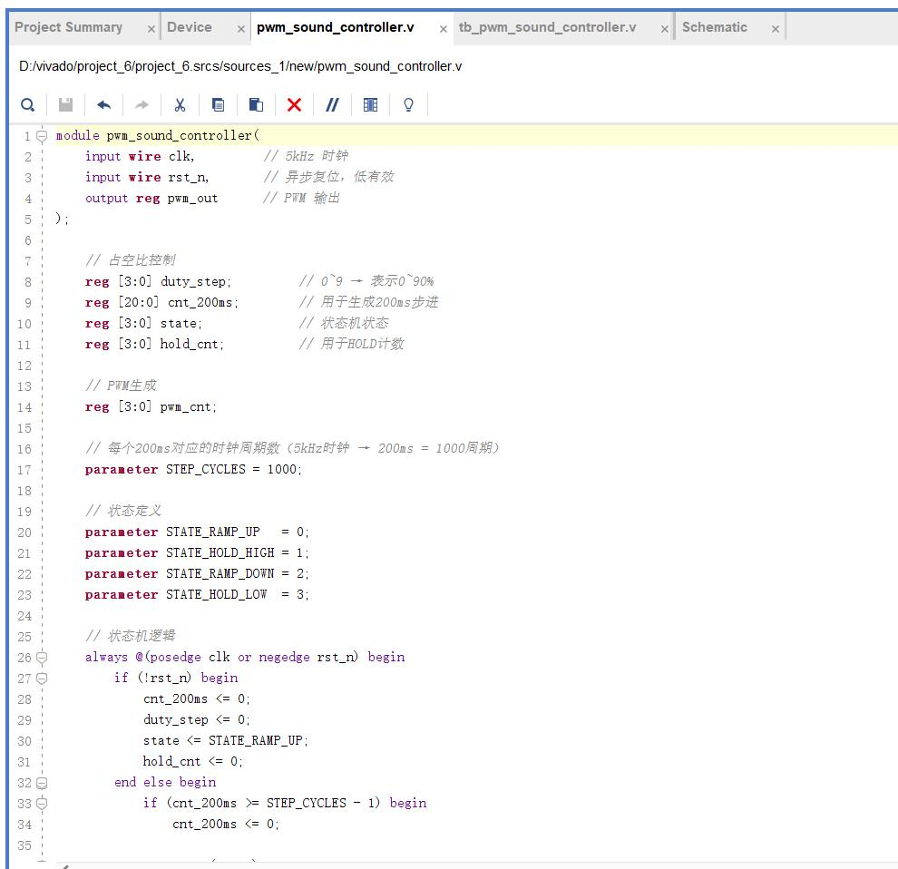
  <br><em><code>pwm_sound_controller.v</code> in the Vivado editor.</em>
</p>

### 3.4 Testbench — `tb_pwm_sound_controller.v`

```verilog
`timescale 1us/1ns
// Simulation clock period 1 us (5 kHz corresponds to a 200 us period)

module tb_pwm_sound_controller;

    reg  clk;
    reg  rst_n;
    wire pwm_out;

    pwm_sound_controller uut (
        .clk(clk),
        .rst_n(rst_n),
        .pwm_out(pwm_out)
    );

    // 5 kHz = 200 us period -> simulated clock
    initial begin
        clk = 0;
        forever #100 clk = ~clk;   // 100 us -> 5 kHz
    end

    // Stimulus
    initial begin
        rst_n = 0;
        #500;
        rst_n = 1;

        // Run long enough to observe a complete envelope (e.g. 20 s)
        #200000;

        $stop;
    end

endmodule
```

→ [`tb/tb_pwm_sound_controller.v`](tb/tb_pwm_sound_controller.v)

<p align="center">
  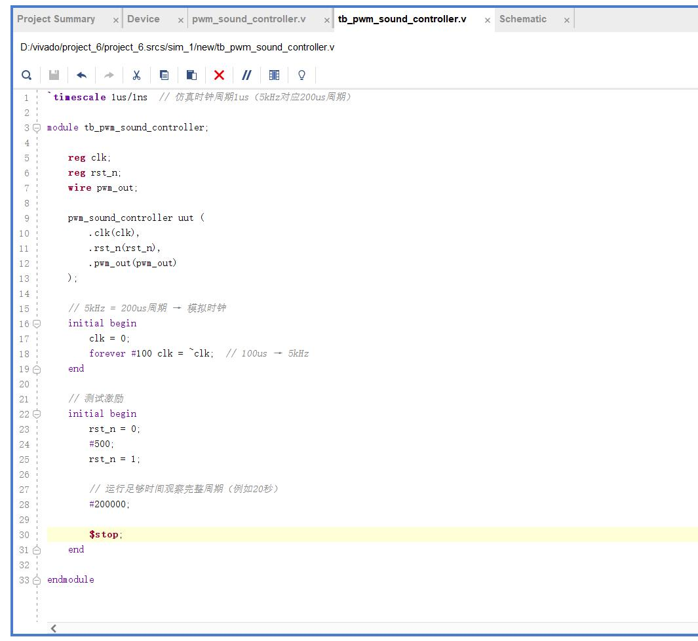
  <br><em>Testbench in the Vivado editor.</em>
</p>

### 3.5 Running the simulation

The simulation source was right-clicked → `Set as Top`, then `Run Simulation` was started from the Flow Navigator. The testbench is used as the simulation entry point, the built-in Vivado simulator performs RTL functional verification, and the waveform window and simulation report are displayed when it completes.

---

## 4. Results

### 4.1 Simulation waveform

<p align="center">
  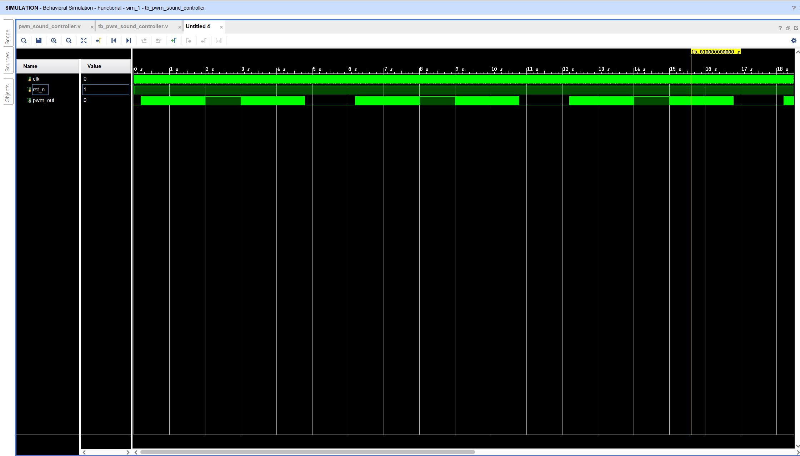
  <br><em>Simulation waveform of the PWM "aria" generator.</em>
</p>

Three signals were examined:

**1. Clock `clk`** — a clean square wave at the design frequency, with the period consistent with the 0.2 ms specified in the requirements. The clock is therefore the timing reference against which the 200 ms envelope step and the 1 s holds are built.

**2. Reset `rst_n`** — an **active-low asynchronous reset**. It is asserted (low) at the start of the simulation to initialise `duty_step`, `cnt_200ms`, `state`, `hold_cnt`, `pwm_cnt` and `pwm_out`, and is then de-asserted for the remainder of the run. The initial 500 ns assertion is what guarantees the envelope starts from a known state (`STATE_RAMP_UP`, `duty_step = 0`) rather than from an undefined value.

**3. PWM output `pwm_out`** — the envelope, which shows the four distinct regions required by the specification:

| Region | Observed waveform | Interpretation |
|--------|-------------------|----------------|
| Hold low | `pwm_out` continuously low | buzzer silent (0 % duty) |
| Ramp up | duty cycle grows progressively from 0 % to 100 % | volume increases |
| Hold high | duty cycle remains at 100 % | buzzer at maximum loudness |
| Ramp down | duty cycle shrinks progressively from 100 % back to 0 % | volume decreases |

The waveform confirms that the designed generator produces the required effect: volume swells from silence to maximum, then fades back to silence, then repeats. The time allocated to each region also matches the specification (2 s rise, 1 s hold at maximum, 2 s fall, 1 s silence), because the state transitions are driven by the 200 ms tick counter.

### 4.2 Synthesis and hardware implementation

`Run Synthesis` was executed from the Flow Navigator (converting the HDL to a gate-level netlist), followed by `Open Synthesized Design` and `Tools ▸ Schematic`.

<p align="center">
  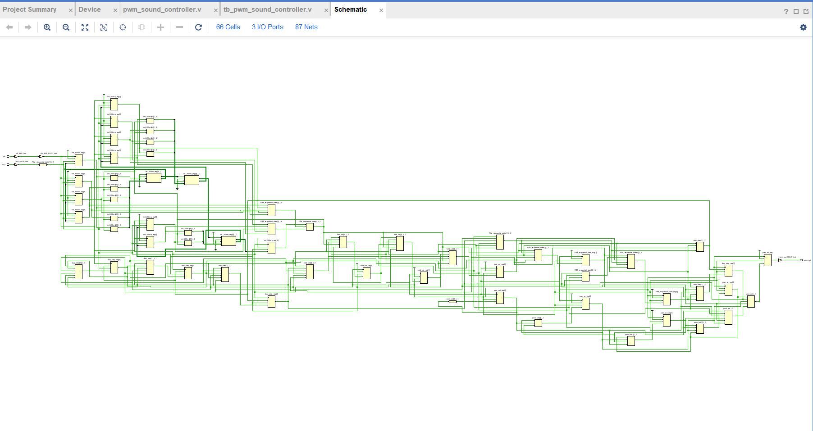
  <br><em>Synthesised schematic of the design.</em>
</p>

Key hardware figures extracted from the project summary:

**Design scale and structure**

- **Logic scale: 60 cells** (LUTs, flip-flops and other primitives) — a small-to-medium design.
- **Interconnect complexity: 87 nets** — signal interaction between blocks is lean.

**Implementation characteristics**

- **Pure logic architecture** — no BRAM, DSP or other dedicated blocks are instantiated.
- **Compact design** — the low cell-to-net ratio (≈ 1 : 1.45) indicates that (a) the core control is implemented as an efficient state machine, and (b) part of the computation logic is reused (e.g. the counter is shared between functions) rather than duplicated.

---

## 5. Discussion

### 5.1 Theory meeting practice

The PWM principle and state-machine design both became concrete here. Translating an abstract duty-cycle number into an audible swell-and-fade is a direct demonstration of how digital signal modulation is implemented in real hardware — the "signal" is nothing more than a counter/comparator pair driving a pin.

### 5.2 The importance of timing control

The envelope requires precise control at three different time scales simultaneously: the 0.2 ms clock period, the 0.2 s step interval, and the 1 s holds. Making those agree means explicitly computing and then *verifying* clock-cycle counts (`STEP_CYCLES = 1000`, `hold_cnt < 4` for five ticks). This is the practical form of the timing budget in hardware design.

### 5.3 State-machine design

A clearly separated four-state machine (ramp up / hold high / ramp down / hold low) is what makes the envelope tractable. The lesson generalises: complex sequential behaviour becomes clear and controllable once it is partitioned into states, and the correctness of the system depends directly on the precision of the state-transition conditions.

### 5.4 Debugging technique

Problems encountered during development included uneven volume progression and late state transitions. Segmenting the simulation and observing the individual signals (particularly `duty_step` and the 200 ms tick) allowed the cause to be located incrementally. Resolving them built up a repeatable debugging workflow rather than a one-off fix.

### 5.5 Resource efficiency

Considerations around counter bit width and comparator implementation led to a design that satisfies the functional requirement with a minimal resource footprint — in this case 60 cells and 87 nets, with the counter shared between the envelope and PWM blocks. Balancing resource usage against performance is a design decision, not an accident.

### 5.6 Extending the idea

Once the base requirement was met, modifying the parameters to produce different envelope shapes (for example a non-linear swell, or asymmetric rise/fall times) was straightforward — a demonstration of how parameterising a design creates room for further development.

---

## 6. Note on the listings in this report

The Verilog listings were transcribed from the code text published in the original document. The source text was published with line wrapping applied; the listing above restores the original indentation and line breaks without altering any statement.

---

## Appendix — full figure gallery

<details>
<summary><strong>Click to expand all 13 captures from this laboratory</strong></summary>

| # | Figure | Description |
|---|--------|-------------|
| 01 | 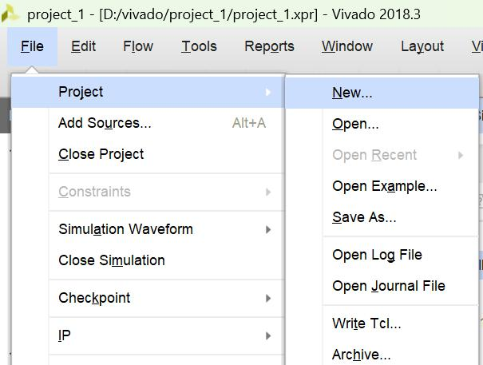 | Creating the project |
| 02 | 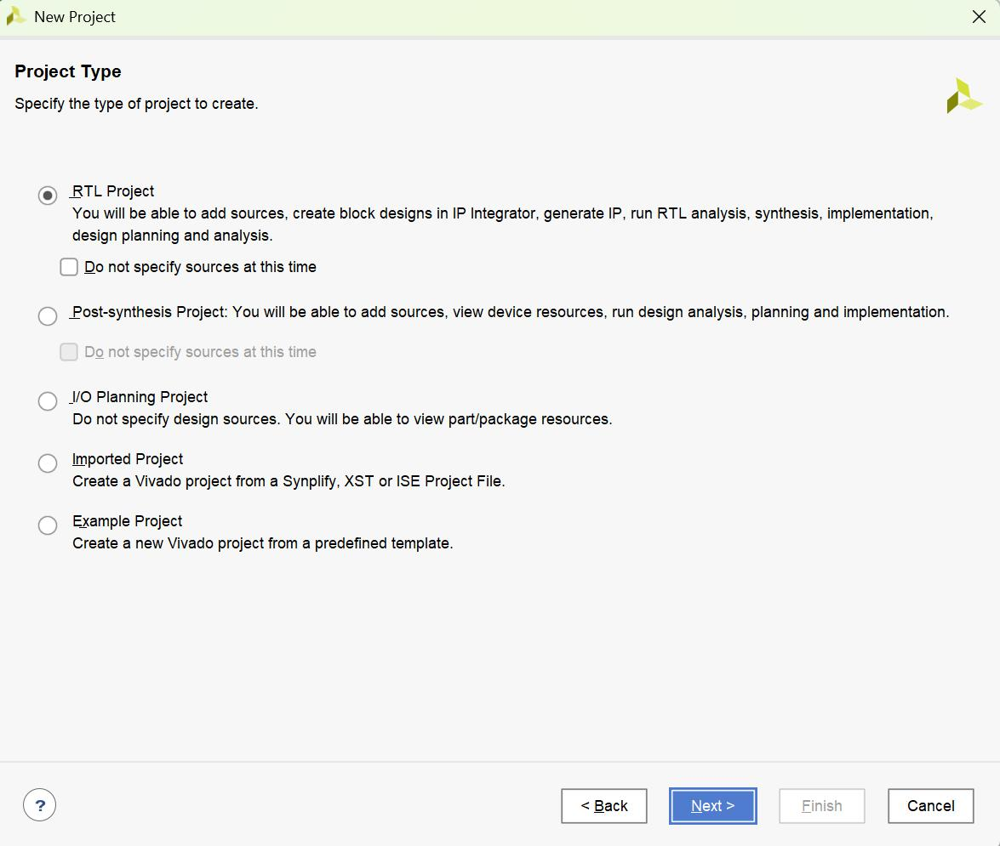 | Project creation wizard |
| 03 | 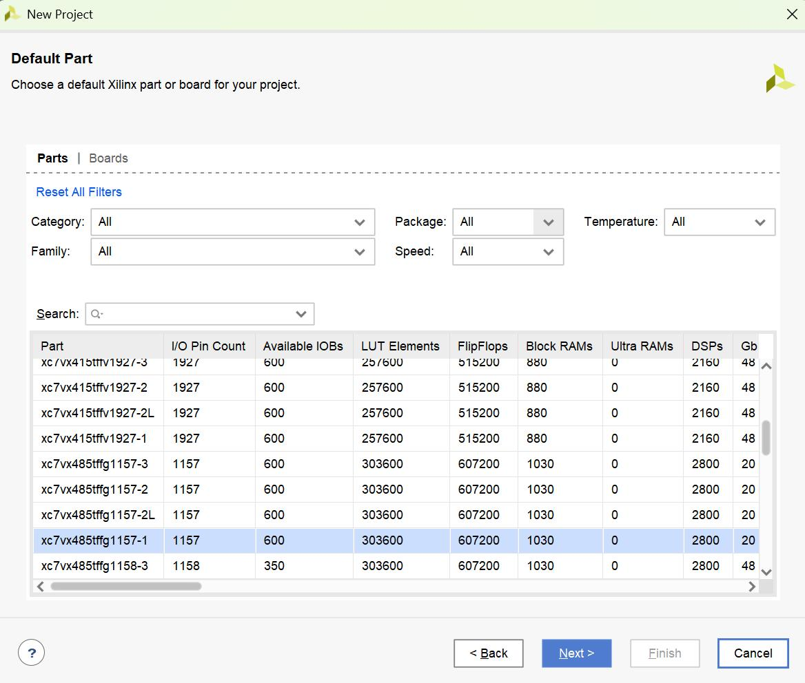 | Add Sources |
| 04 | 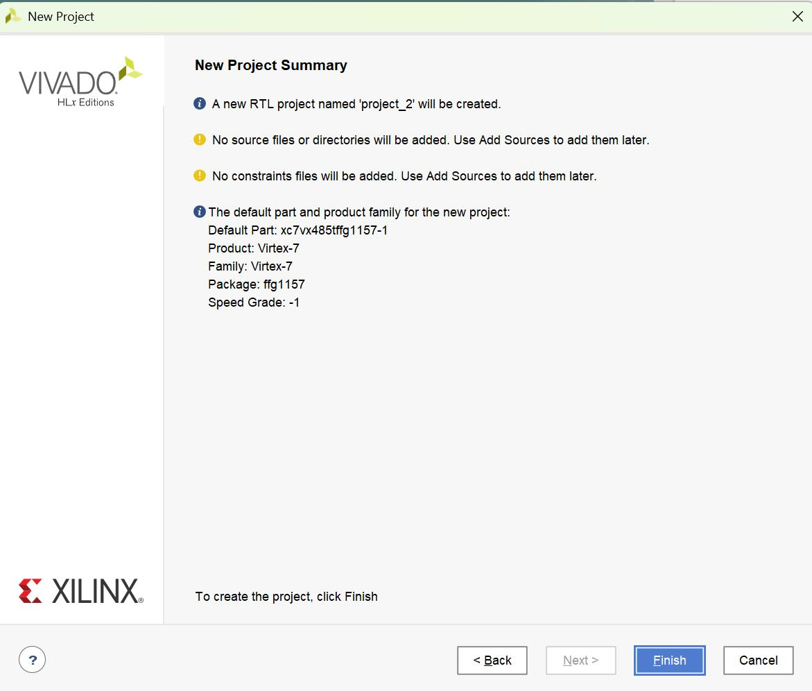 | Project configuration |
| 05 | 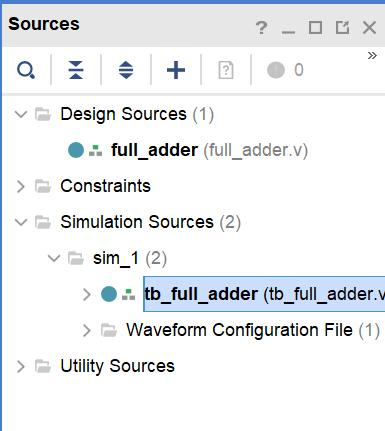 | File naming |
| 06 | 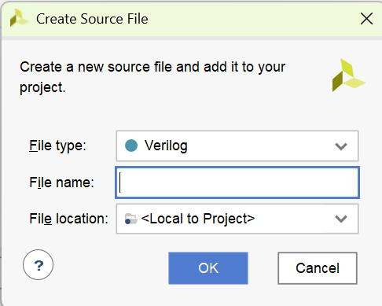 | Creating the simulation source |
| 07 | 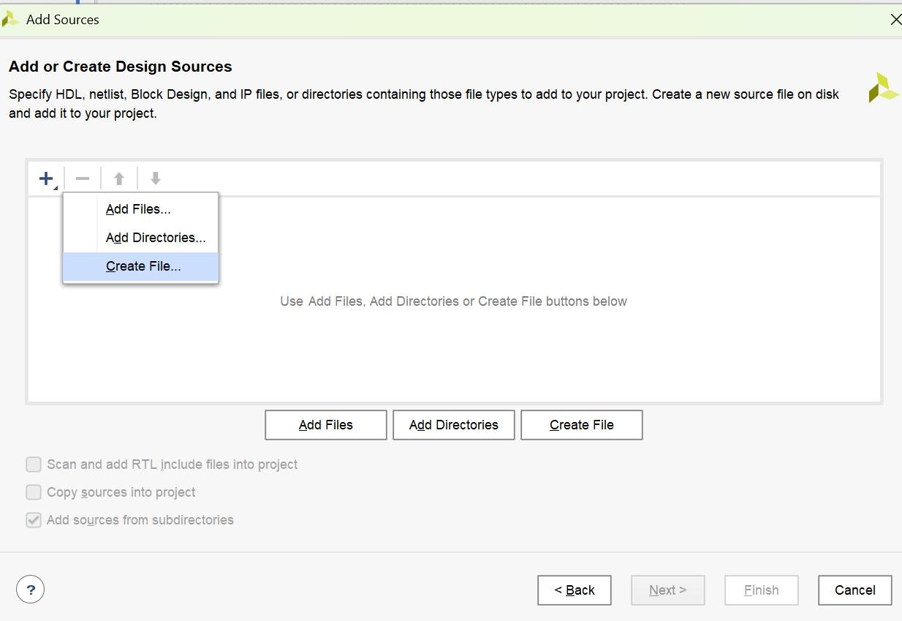 | Sources panel |
| 08 |  | Design source |
| 09 |  | Testbench |
| 10 |  | Running the simulation |
| 11 |  | Simulation waveform |
| 12 | 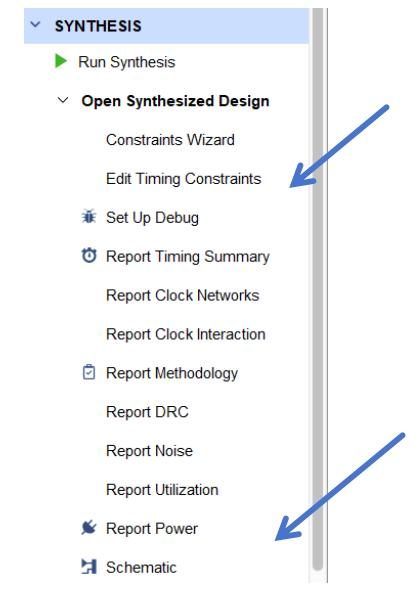 | Synthesis |
| 13 |  | RTL schematic |

</details>
